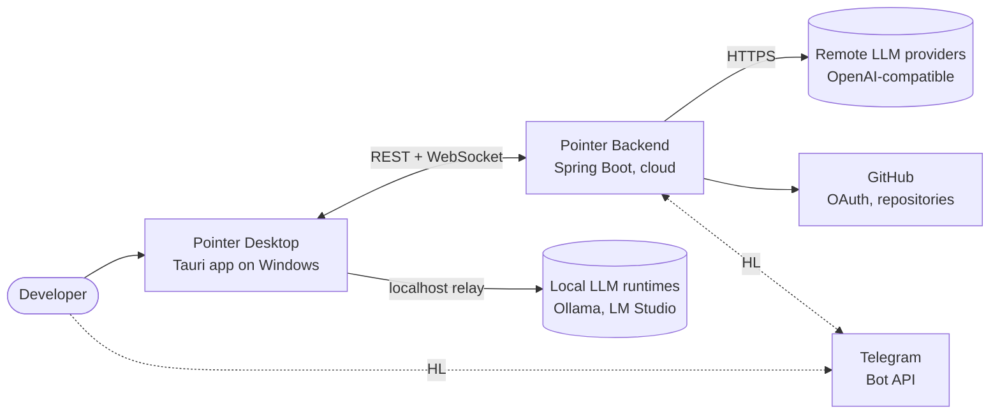
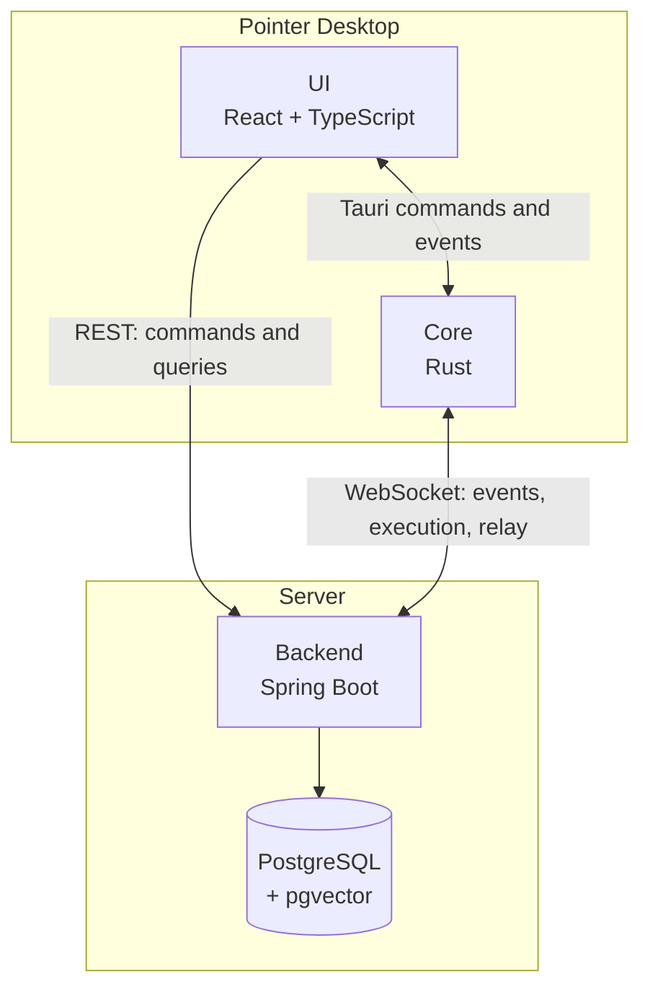
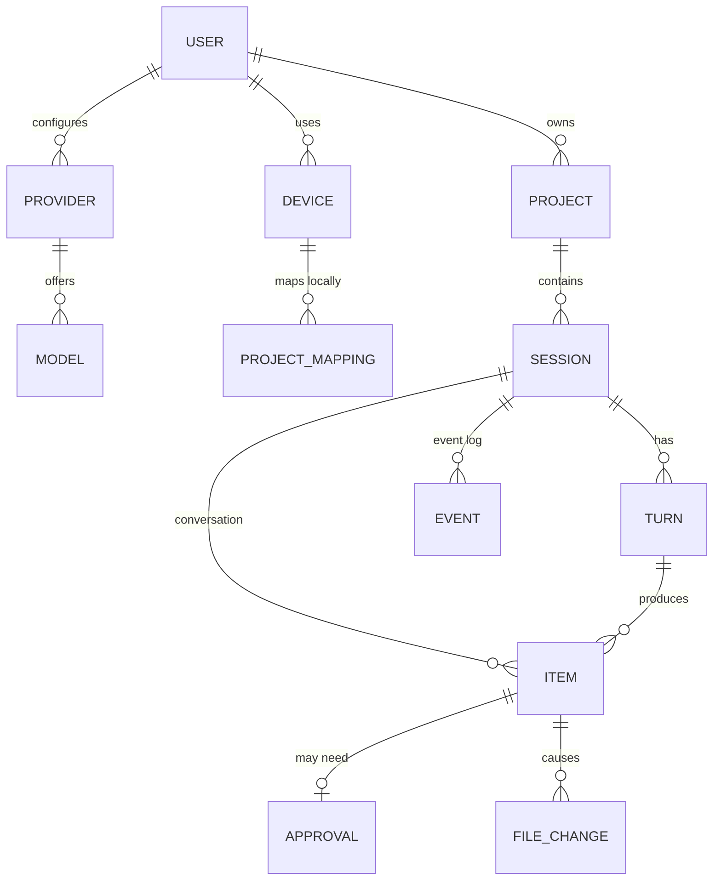
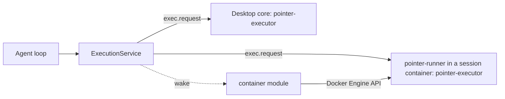
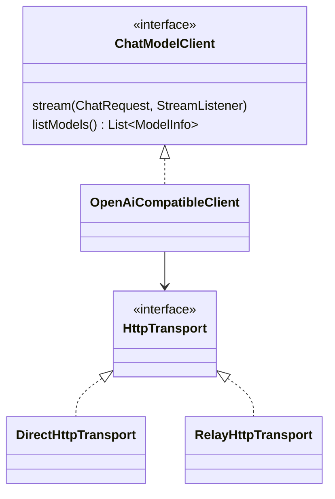
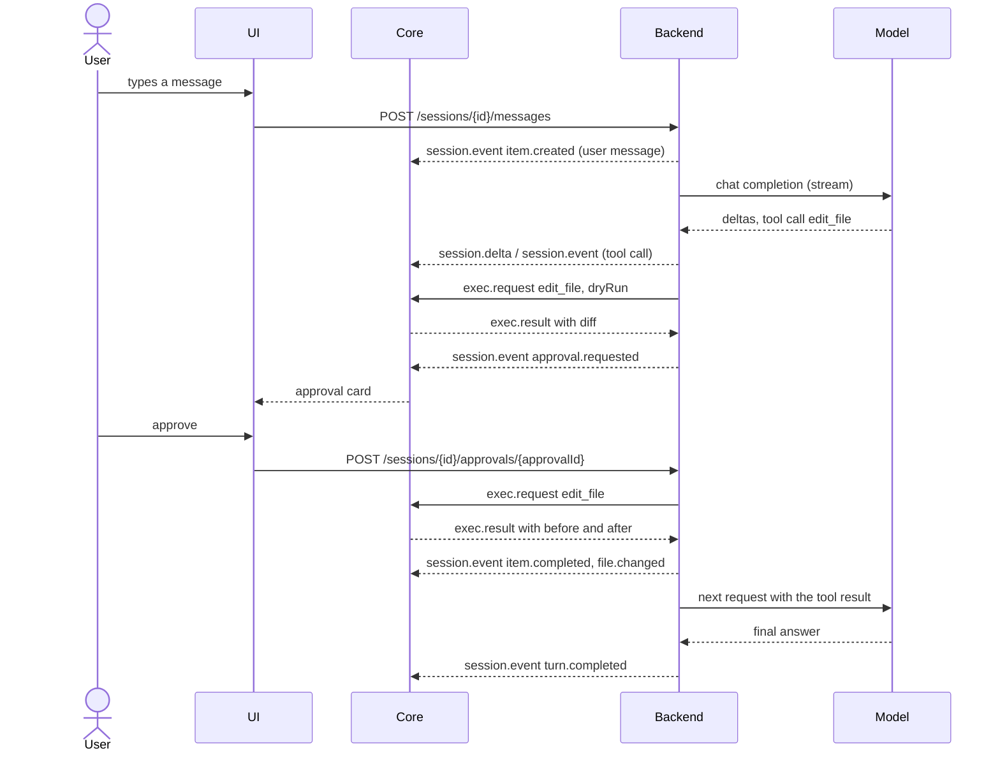
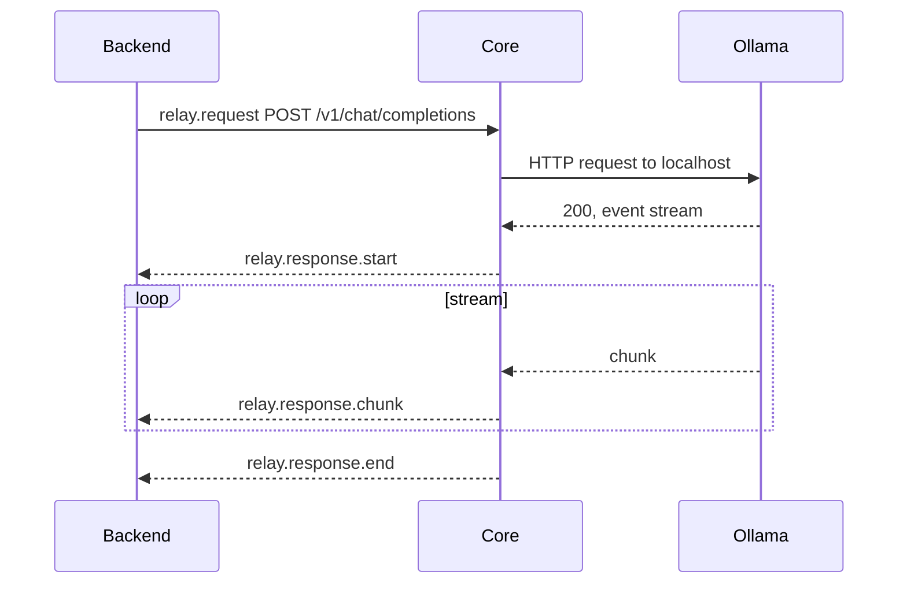

# Pointer: Architecture

This document describes how Pointer is structured and how its parts cooperate.
Decisions and their reasoning are in [ADRs](adr/README.md). The wire protocol is in [03-protocol.md](03-protocol.md).

## 1. System context



| External system | Role |
|---|---|
| Remote LLM providers | Chat completions with streaming and tool calling, reached directly by the backend. |
| Local LLM runtimes | Same API on the user's machine, reached through the desktop relay ([ADR 0003](adr/0003-local-models-via-client-relay.md)). |
| GitHub | OAuth sign-in; repository access for remote execution later. |
| Telegram | Highlight feature: an additional client for sessions. |

## 2. Containers



| Container | Responsibility |
|---|---|
| UI | All screens. Calls REST for commands and queries. Receives realtime session events from the core. |
| Core | Owns the refresh token and the WebSocket connection. Executes tool calls, relays local LLM requests, stores the device's project-path mapping, shows notifications, completes GitHub sign-in through a loopback redirect. |
| Backend | Accounts, providers, projects, sessions, the agent loop, context assembly, the tool registry, permission policies, execution dispatch, persistence. |
| PostgreSQL | Durable state: users, providers, projects, sessions, conversation items, events, file changes, policies. Later embeddings. |

Communication split ([ADR 0007](adr/0007-communication-model.md)):

- **REST** for everything the user initiates: sign-in, CRUD, sending a message, answering an approval, cancelling a turn.
- **WebSocket** for everything the server pushes or needs from the device: session events, tool execution, LLM relay.

## 3. Key concepts



- **Device.** One installation of the desktop app, identified by a generated `deviceId`.
- **Project mapping.** The local path of a project lives only on the device. The backend knows the project, not the path.
- **Session.** Belongs to a project and is pinned to the device that executes it (the executor device).
- **Turn.** One run of the agent loop triggered by a user message.
- **Item.** One element of the conversation: user message, assistant message, reasoning, tool call, plan, compaction summary. Items are what the model sees.
- **Event.** One entry of the session's ordered log (`seq` 1, 2, 3, …). Events are what clients see. Item creation and completion are events; streaming deltas are not stored.

## 4. Backend

### 4.1 Modules

The backend is a modular monolith, packaged by feature under `dev.pointer`.
A module exposes a small public API (services, DTOs, domain events) and keeps everything else package-private or in an `internal` subpackage.

| Module | Responsibility |
|---|---|
| `auth` | Registration, password and GitHub sign-in, JWT issuing, refresh-token rotation. |
| `user` | Profile, global settings, global instructions, language preference. |
| `device` | Device registration and presence: which devices are connected, with which capabilities and projects. |
| `provider` | Provider and model configuration including vision support and prices for cost estimates, key encryption, the LLM client, direct and relay transports. |
| `project` | Projects and project-level settings. |
| `session` | Sessions, turns, items, image attachments, the event log, event fan-out to subscribers. |
| `agent` | The agent loop, modes, context assembly, compaction, title generation. |
| `tool` | Tool registry, tool definitions and schemas, permission policies and evaluation. |
| `execution` | Executor abstraction, dispatching calls, correlating results, timeouts. |
| `review` | File change records, diffs, revert, rewind to a turn. |
| `worktree` | Session worktrees: creation, status, merge and discard through executor operations ([ADR 0011](adr/0011-session-worktrees.md)). |
| `command` | User-defined slash commands. |
| `customtool` | Agent-proposed custom tools: proposal validation, versions, approval outcome, management REST ([ADR 0014](adr/0014-agent-proposed-custom-tools.md)). |
| `telegram` | Telegram remote control: account linking, long polling of the Bot API, commands, inline approvals, progress and answer notifications ([ADR 0015](adr/0015-telegram-remote-control.md)). |
| `container` | Remote execution: server sessions on a per-session Docker container running the headless runner, GitHub repository access, commit and push after each turn, pull requests, idle stop ([ADR 0016](adr/0016-remote-execution-in-containers.md)). |
| `rag` | Semantic project index: scanning and chunking through the executor, embeddings through the user's provider, pgvector storage, the server-side `semantic_search` operation ([ADR 0013](adr/0013-semantic-code-index.md)). |
| `gateway` | WebSocket endpoint: authentication, protocol parsing, routing to modules. |
| `common` | Cross-cutting basics: error model, ids, clock, JSON. |

DTOs are records; Lombok is limited to constructor injection and entity getters ([ADR 0012](adr/0012-lombok-for-boilerplate.md)).

Highlight modules plug in without touching the agent loop: `rag`, `customtool`, `telegram` and `container`. Tools whose operation has a `ServerOperation` bean are executed by the backend instead of the device; `ExecutionService` routes them, and the registry hides them when they are unavailable for the project.

### 4.2 Agent loop

One turn runs on its own virtual thread and is written as plain sequential code.

```mermaid
flowchart TD
    start([User message accepted]) --> ctx[Assemble context]
    ctx --> compact{Near context limit?}
    compact -- yes --> summarize[Compact history] --> call
    compact -- no --> call[Call model, stream deltas]
    call --> calls{Tool calls in response?}
    calls -- no --> done([Turn completed])
    calls -- yes --> each[For each tool call]
    each --> mode{Allowed in mode?}
    mode -- no --> reject[Return error to model]
    mode -- yes --> policy{Permission policy}
    policy -- deny --> reject
    policy -- ask --> approval[Request approval and wait]
    approval -- denied --> reject
    approval -- approved --> exec
    policy -- allow --> exec[Dispatch to executor and wait]
    exec --> result[Append tool result]
    reject --> result
    result --> more{More calls?}
    more -- yes --> each
    more -- no --> inbox[Take queued user messages]
    inbox --> limits{Cancelled or step limit?}
    limits -- no --> ctx
    limits -- yes --> stop([Turn stopped])
```

Rules:

- A session runs at most one turn at a time. Different sessions run concurrently.
- Waiting for an approval or a tool result blocks only the turn's virtual thread, on a future completed by the REST or WebSocket handler.
- Cancellation sets a flag checked at every await point, aborts the provider stream and sends `exec.cancel` to running calls.
- Messages sent during a turn are queued and appended at the next step boundary (SESS-6).
- Every state change is written to the event log in the same transaction as the item it describes, then fanned out.
- Running turns are held in memory. On backend restart they are marked `interrupted`. The backend runs as a single instance; horizontal scaling is out of scope.

### 4.3 Context assembly

Built before every model call, in this order:

1. base system instructions;
2. mode instructions (Ask, Plan, Agent);
3. environment: OS, shell, date, project name, git branch (from the executor);
4. global user instructions;
5. project rules (`AGENTS.md` or `CLAUDE.md`, read through the executor at turn start);
6. tool definitions allowed in the current mode;
7. conversation items, starting from the latest compaction summary.

Token counts use the provider's reported usage when available and an estimate otherwise.
Compaction replaces older items with a model-generated summary item. Original items stay in the database and in the client history.
The thresholds and what stays verbatim are described in [ADR 0009](adr/0009-context-compaction-and-plan-approval.md).

### 4.4 Execution



- The agent asks the `execution` module to run an operation on the session's executor device. The loop does not know whether the device is a desktop or a server-side runner.
- `ExecutionService` sends `exec.request` through the gateway to the device and completes the call on `exec.result`.
- The executor operations live in the `pointer-executor` Rust crate, shared by the desktop core and the headless `pointer-runner` binary that runs in a per-session container ([ADR 0016](adr/0016-remote-execution-in-containers.md)).
- Before dispatching, `ExecutionService` asks `ExecutorReadiness` hooks whether the device is ready and wakes it when not. The `container` module uses this to start a stopped container and to hold calls until the repository is cloned.
- If the device is offline, the session status becomes `waiting_for_executor` and the turn waits until it reconnects or the user cancels.
- Tools that modify files return the content before and after, which the `review` module stores as file changes.
- An approval for `write_file` or `edit_file` needs a diff preview. The backend first sends the call with `dryRun: true`, shows the returned diff, and executes the real call after approval.

### 4.5 Providers



- The agent works with internal types (`ChatRequest`, `AssistantDelta`, `ToolCall`), never the OpenAI wire format.
- The OpenAI-compatible client parses server-sent events, including incremental tool-call arguments.
- Remote providers use the direct transport, local ones the relay transport over the device's WebSocket. Both look the same to the client.
- API keys are decrypted only in memory for the duration of a request.

### 4.6 Tools and permissions

- A tool definition stores: name, description, JSON Schema of arguments, kind (`read`, `write`, `execute`), executor operation, and in which modes it is available.
- Built-in tools are seeded into the registry by migrations. MCP tools are reported by devices and custom tools are added when the user approves a proposal, each as registry entries of their own source.
- Policy evaluation for a call:
  1. a session-level approval given earlier ("allow for this session");
  2. command rules for `run_command`, matched by prefix, project rules before global;
  3. the tool's policy, project override before global;
  4. the session auto-approve switch turns `ask` into `allow`, never `deny` into `allow`.

## 5. Desktop

### 5.1 Core (Rust)

| Module | Responsibility |
|---|---|
| `auth` | Refresh token in Windows Credential Manager, access token refresh, GitHub OAuth through a loopback listener ([ADR 0008](adr/0008-github-sign-in-loopback-redirect.md)). |
| `connection` | WebSocket client: handshake, heartbeat, reconnect with backoff, per-session `seq` tracking, routing of incoming messages. |
| `executor` | Implementations of executor operations, including `web_fetch`, the tree-sitter chunking behind `pointer.index_scan` and `pointer.index_chunks`, and the `pointer.worktree_*` operations that run the system `git`. Path guard limiting access to the session root: the project folder or the session worktree ([ADR 0011](adr/0011-session-worktrees.md)). |
| `process` | Running commands in PowerShell, streaming output, killing the whole process tree on cancel (Windows job objects). |
| `relay` | HTTP requests to local LLM runtimes, streaming responses back. Allows only loopback hosts and hosts the user approved on this device. |
| `projects` | Local mapping `projectId → path`, stored in the app data directory. |
| `mcp` | MCP client for the servers configured on this device (stdio and streamable HTTP), reporting their tools to the backend and serving `mcp.call` ([ADR 0010](adr/0010-mcp-servers-on-the-device.md)). |
| `terminal` | Interactive PowerShell sessions in the project folder for the terminal panel (UI-6), through a pseudo console (ConPTY via `portable-pty`). Purely local: terminal input and output never reach the backend. |
| `bridge` | Tauri commands exposed to the UI and events forwarded to it. |

Library choices: `tokio-tungstenite` for the WebSocket, `ignore` and `grep` (the ripgrep crates) for `glob` and `grep` tools, `keyring` for the credential store, `similar` for diffs, `portable-pty` for the terminal; xterm.js renders it in the UI.

### 5.2 UI (React)

```
desktop/src/
├── app/          routing, providers, layout
├── features/
│   ├── auth/
│   ├── projects/
│   ├── sessions/   session list, conversation view, composer, tool call cards, approvals
│   ├── review/     changed files, diff viewer
│   └── settings/   providers, permissions, instructions, language, theme
├── shared/
│   ├── api/        REST client and types generated from OpenAPI
│   ├── realtime/   subscription to session events from the core
│   ├── ui/         shadcn/ui components
│   └── i18n/       i18next setup, locales/en.json, locales/ru.json
└── main.tsx
```

- The UI never holds the refresh token. It asks the core for a fresh access token for REST calls.
- Session state in the UI is rebuilt from events: the history comes from REST, then live events from the core keep it current.

## 6. Key flows

### 6.1 A turn with an approved edit



### 6.2 Local model through the relay



### 6.3 Reconnect

1. The connection drops. The core reconnects with backoff.
2. On `hello` it reports its projects and any finished execution results it could not deliver.
3. For each open session it sends `session.subscribe` with the last received `seq`.
4. The backend replays stored events after that `seq`, then sends a snapshot of any item still streaming.
5. Sessions waiting for this device's executor resume.

## 7. Security

| Concern | Measure |
|---|---|
| Transport | TLS for REST and WebSocket in deployment. |
| Identity | Short-lived JWT access tokens, rotating refresh tokens, PKCE for GitHub OAuth. |
| Secrets | Provider keys encrypted with AES-GCM, master key from the environment. Keys never leave the backend after saving. |
| Local execution | The core executes only operations from its authenticated backend connection, for projects mapped on this device, inside the project root. |
| Destructive actions | Permission policies and approvals. Process trees are killed on cancel. |
| Relay abuse | The relay accepts only loopback hosts and hosts the user approved on the device. |
| Data isolation | Every query is scoped by user id. Session subscriptions check ownership. |

## 8. Deployment

Development:

```
infra/docker-compose.yml   PostgreSQL with pgvector
backend/                   run from the IDE or ./gradlew bootRun
desktop/                   npm run tauri dev
```

Later, cloud: the backend as a container behind a reverse proxy with TLS, the same Compose file with an added backend service.

## 9. Extension points for highlight features

| Feature | Extension point | Changes to the agent loop |
|---|---|---|
| Telegram control | New client of the `session` module: a `SessionEventListener` notified after commit next to the WebSocket fan-out, calls the same services as REST. | None |
| RAG | `rag` module with indexing triggered by executor file events; `semantic_search` tool in the registry. | None |
| Custom tools | Registry entries with source `custom`, the server-side `propose_tool` approved like a tool call, the executor operation `custom_tool.run` running the approved script on the device. | Dispatch of `propose_tool`; the tool list is rebuilt before every model call |
| Remote execution | A runner device per session in a container, started by the `container` module through the `ExecutorReadiness` hook; commit and push through a `SessionEventListener` on `turn.completed`. | None; the environment section of the system prompt reports the executor's OS and shell |
