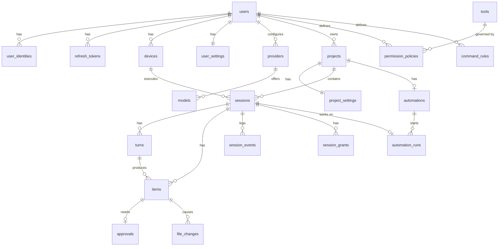

# Pointer: Data Model

PostgreSQL schema of the backend. Concepts are introduced in [02-architecture.md](02-architecture.md#3-key-concepts), wire formats in [03-protocol.md](03-protocol.md).

## 1. Conventions

- Table and column names are `snake_case`, tables in plural.
- Primary keys are `uuid` values of version 7 (time-ordered), generated by the application.
- Timestamps are `timestamptz` named `*_at`. Every table has `created_at`; mutable tables also have `updated_at`.
- Enumerations are `text` columns with `CHECK` constraints, mirroring the protocol values.
- Type-specific or evolving structures are `jsonb` (item payloads, event payloads, settings). Anything used for filtering, joining or uniqueness is a real column.
- Every user-owned row is reachable from `user_id`, and every query is scoped by it.
- Deletion is hard with `ON DELETE CASCADE` down the ownership tree. Archiving is a timestamp column.
- Schema changes are Flyway migrations in `backend/src/main/resources/db/migration`, named `V<n>__<description>.sql`. Built-in tools are seeded by migrations.
- Requires PostgreSQL 16+ with the `vector` extension (used from the RAG milestone) and `citext`.

## 2. Overview

## 3. Accounts

### `users`

| Column | Type | Notes |
|---|---|---|
| `id` | uuid | PK |
| `email` | citext | Unique, required; GitHub accounts use the verified primary email ([ADR 0008](adr/0008-github-sign-in-loopback-redirect.md)) |
| `password_hash` | text | Nullable for accounts without a password |
| `display_name` | text | |
| `locale` | text | `en`, `ru`; default `en` |
| `disabled_at` | timestamptz | Nullable |
| `created_at`, `updated_at` | timestamptz | |

### `user_identities`

External identities linked to a user (AUTH-3, AUTH-4).

| Column | Type | Notes |
|---|---|---|
| `id` | uuid | PK |
| `user_id` | uuid | FK `users` |
| `provider` | text | `github` |
| `provider_user_id` | text | Stable id at the provider |
| `provider_login` | text | |
| `access_token_encrypted` | bytea | Nullable; stored when the user grants repository access (`repo` scope), encrypted like provider keys |
| `scopes` | text | Granted scopes |
| `created_at`, `updated_at` | timestamptz | |

Unique: (`provider`, `provider_user_id`), (`user_id`, `provider`).

### `refresh_tokens`

| Column | Type | Notes |
|---|---|---|
| `id` | uuid | PK |
| `user_id` | uuid | FK `users` |
| `device_id` | uuid | FK `devices`, nullable |
| `family_id` | uuid | All rotations of one sign-in share a family; reuse of a rotated token revokes the family |
| `token_hash` | text | Unique; SHA-256 of the opaque token |
| `expires_at` | timestamptz | |
| `rotated_at` | timestamptz | Nullable |
| `revoked_at` | timestamptz | Nullable |
| `created_at` | timestamptz | |

### `devices`

| Column | Type | Notes |
|---|---|---|
| `id` | uuid | PK; generated by the client on first launch |
| `user_id` | uuid | FK `users` |
| `name` | text | Editable |
| `platform` | jsonb | OS, version, shell from `hello` |
| `client_version` | text | |
| `last_seen_at` | timestamptz | |
| `revoked_at` | timestamptz | Nullable |
| `kind` | text | `desktop` or `runner` (the device of a server session, [ADR 0016](adr/0016-remote-execution-in-containers.md)) |
| `runner_secret_hash` | text | Nullable; SHA-256 of the runner secret, cleared on revoke |
| `capabilities` | text[] | Capabilities of the latest `hello` (`executor`, `desktop`, ...), sorted; empty until the device first connects. Decides the tools of an offline device (F7, GUI-4) |
| `created_at`, `updated_at` | timestamptz | |

Connection presence is kept in memory, not in the database.

### `user_settings`

| Column | Type | Notes |
|---|---|---|
| `user_id` | uuid | PK, FK `users` |
| `global_instructions` | text | PROJ-4 |
| `default_model_id` | uuid | FK `models`, nullable, `ON DELETE SET NULL` |
| `embedding_model_id` | uuid | FK `models`, nullable, `ON DELETE SET NULL`; model used for semantic indexes (CTX-7) |
| `routing_default` | text | `off` (default) or `smart`; routing of new sessions (ROUTE-1) |
| `context_strategy_default` | text | `summary` (default), `masking` or `hybrid`; context strategy of new sessions (CACHE-4) |
| `escalation_default` | text | `off` (default) or `on`; escalation of new sessions (ESC-1) |
| `fast_model_id`, `plan_model_id` | uuid | FK `models`, nullable, `ON DELETE SET NULL`; role models for smart routing (ROUTE-2) |
| `explore_model_id` | uuid | FK `models`, nullable, `ON DELETE SET NULL`; model of the `explore` sub-agent in both routing modes (ROUTE-4) |
| `preferences` | jsonb | Theme, notification and UI preferences |
| `updated_at` | timestamptz | |

### `slash_commands`

User-defined slash commands (UI-7). The client expands `/name arguments` into the prompt before sending; `$ARGUMENTS` in the prompt is replaced with the arguments, otherwise they are appended.

| Column | Type | Notes |
|---|---|---|
| `id` | uuid | PK |
| `user_id` | uuid | FK `users` |
| `name` | text | `[a-z0-9][a-z0-9-]{0,39}` |
| `description` | text | Shown in the composer suggestions |
| `prompt` | text | |
| `created_at`, `updated_at` | timestamptz | |

Unique: (`user_id`, `name`).

## 4. Providers and models

### `providers`

| Column | Type | Notes |
|---|---|---|
| `id` | uuid | PK |
| `user_id` | uuid | FK `users` |
| `name` | text | |
| `adapter` | text | `openai_compatible`; more values for specialized adapters (PROV-8) |
| `base_url` | text | |
| `api_key_encrypted` | bytea | Nullable; AES-GCM, nonce prefixed |
| `api_key_hint` | text | Last 4 characters, for display |
| `is_local` | boolean | Requests go through the relay (PROV-2) |
| `sends_cache_key` | boolean | Default false; chat requests carry `prompt_cache_key` with the session id (CACHE-6) |
| `created_at`, `updated_at` | timestamptz | |

### `models`

| Column | Type | Notes |
|---|---|---|
| `id` | uuid | PK |
| `provider_id` | uuid | FK `providers` |
| `model_key` | text | Model id at the provider, for example `gpt-5` |
| `display_name` | text | |
| `context_window` | integer | Nullable until known (PROV-6) |
| `max_output_tokens` | integer | Nullable |
| `supports_tools` | boolean | Default true |
| `supports_vision` | boolean | Default false |
| `input_price_per_mtok` | numeric(12,6) | Nullable (CTX-6) |
| `cached_input_price_per_mtok` | numeric(12,6) | Nullable; price of prompt tokens the provider serves from its cache; the input price applies when null (CACHE-1) |
| `output_price_per_mtok` | numeric(12,6) | Nullable |
| `embedding_query_prefix`, `embedding_document_prefix` | text | Nullable; prepended to search queries and to indexed chunks when the model computes embeddings (CTX-9). Filled for known families when the model is created: `nomic-embed`, `e5`, `bge-small/base/large`, `mxbai-embed`, `snowflake-arctic-embed` |
| `coordinate_system` | text | `pixels` (default) or `normalized`: how the model addresses a screenshot, in pixels of the image or on a 0–1000 grid (F7, GUI-3) |
| `source` | text | `discovered`, `manual` |
| `enabled` | boolean | |
| `created_at`, `updated_at` | timestamptz | |

Unique: (`provider_id`, `model_key`).

### Model fallbacks

`model_fallbacks`: the ordered models to try when a model is unavailable ([F3](features/f3-model-routing.md), ROUTE-5).

| Column | Type | Notes |
|---|---|---|
| `model_id` | uuid | FK `models`, cascade |
| `position` | integer | Order in the list, from 0 |
| `fallback_model_id` | uuid | FK `models`, cascade; differs from `model_id` |

Primary key: (`model_id`, `position`). Unique: (`model_id`, `fallback_model_id`).

## 5. Projects and permissions

### `projects`

| Column | Type | Notes |
|---|---|---|
| `id` | uuid | PK |
| `user_id` | uuid | FK `users` |
| `name` | text | Defaults to the folder name |
| `repository` | text | Nullable; GitHub `owner/name` used by server sessions |
| `archived_at` | timestamptz | Nullable |
| `created_at`, `updated_at` | timestamptz | |

Local paths are stored only on devices.

### `project_settings`

| Column | Type | Notes |
|---|---|---|
| `project_id` | uuid | PK, FK `projects` |
| `default_model_id` | uuid | FK `models`, nullable |
| `preferences` | jsonb | |
| `updated_at` | timestamptz | |

### `tools`

The tool registry (TOOL-8).

| Column | Type | Notes |
|---|---|---|
| `id` | uuid | PK |
| `name` | text | Name the model sees |
| `description` | text | |
| `parameters_schema` | jsonb | JSON Schema of arguments |
| `kind` | text | `read`, `write`, `execute` |
| `operation` | text | Executor operation to invoke |
| `modes` | text[] | Modes where the tool is available |
| `default_policy` | text | `allow`, `ask`, `deny` |
| `source` | text | `builtin`, `mcp` (reported by a device, see [ADR 0010](adr/0010-mcp-servers-on-the-device.md)), `custom` (proposed by the agent, see [ADR 0014](adr/0014-agent-proposed-custom-tools.md)) |
| `mcp_server`, `mcp_tool` | text | Original server and tool names of an MCP tool, null otherwise |
| `interpreter` | text | `python`, `node`, `powershell` or `bash` for custom tools, null otherwise |
| `owner_user_id` | uuid | Null for built-in tools |
| `project_id` | uuid | Null unless a project-scoped custom tool |
| `version` | integer | Current version of a custom tool, 1 otherwise |
| `enabled` | boolean | |
| `created_at`, `updated_at` | timestamptz | |

Unique: (`name`, `owner_user_id`, `project_id`) with `NULLS NOT DISTINCT`.

The desktop tools of F7 are built-in rows whose `operation` starts with `desktop_`: V35 seeds eleven of them, V37 adds `desktop_tree` and gives `desktop_click` the `elementId` argument.

### `permission_policies`

Overrides of a tool's default policy (PERM-1, PERM-5).

| Column | Type | Notes |
|---|---|---|
| `id` | uuid | PK |
| `user_id` | uuid | FK `users` |
| `project_id` | uuid | FK `projects`, null for global |
| `tool_id` | uuid | FK `tools` |
| `policy` | text | `allow`, `ask`, `deny` |
| `created_at`, `updated_at` | timestamptz | |

Unique: (`user_id`, `project_id`, `tool_id`) with `NULLS NOT DISTINCT`.

### `command_rules`

Prefix rules for `run_command` (PERM-4).

| Column | Type | Notes |
|---|---|---|
| `id` | uuid | PK |
| `user_id` | uuid | FK `users` |
| `project_id` | uuid | FK `projects`, null for global |
| `prefix` | text | Matched against the normalized command |
| `policy` | text | `allow`, `ask`, `deny` |
| `created_at` | timestamptz | |

## 6. Sessions

### `sessions`

| Column | Type | Notes |
|---|---|---|
| `id` | uuid | PK |
| `user_id` | uuid | FK `users`; denormalized for scoping |
| `project_id` | uuid | FK `projects` |
| `executor_device_id` | uuid | FK `devices` |
| `title` | text | |
| `title_generated` | boolean | False once the user renames |
| `mode` | text | `ask`, `plan`, `agent` |
| `model_id` | uuid | FK `models`, `ON DELETE SET NULL` |
| `status` | text | `idle`, `running`, `waiting_for_approval`, `waiting_for_executor`, `error` |
| `auto_approve` | boolean | PERM-6 |
| `last_seq` | bigint | Last event sequence number |
| `worktree_branch` | text | Nullable; branch of the session worktree ([ADR 0011](adr/0011-session-worktrees.md)) |
| `worktree_base_branch` | text | Branch the worktree was created from and merges into |
| `worktree_state` | text | `active`, `merged`, `discarded`; null for regular sessions |
| `context_tokens` | integer | Current context size |
| `total_input_tokens` | bigint | |
| `total_output_tokens` | bigint | |
| `estimated_cost` | numeric(14,6) | Sum of call costs from model prices at the time of each call; null until a priced model is used (CTX-6) |
| `budget_usd` | numeric(10,4) | Nullable; turns stop with `budget_exceeded` once `estimated_cost` reaches it (ROUTE-6) |
| `routing` | text | `off` (default) or `smart` (ROUTE-1) |
| `context_strategy` | text | `summary` (default), `masking` or `hybrid`: how the model's view of old history is shortened (CACHE-4) |
| `escalation` | text | `off` (default) or `on`: with smart routing, steps start on the fast model and a struggling turn moves to the session model (ESC-1) |
| `archived_at` | timestamptz | Nullable |
| `created_at`, `updated_at` | timestamptz | |

Index: (`project_id`, `updated_at` desc).

### `turns`

| Column | Type | Notes |
|---|---|---|
| `id` | uuid | PK |
| `session_id` | uuid | FK `sessions` |
| `number` | integer | 1, 2, 3 within the session |
| `kind` | text | `message` or `compaction` |
| `mode` | text | Mode at turn start |
| `model_id` | uuid | FK `models`, nullable |
| `status` | text | `running`, `completed`, `cancelled`, `failed`, `step_limit`, `interrupted`, `budget_exceeded` |
| `error` | jsonb | Nullable |
| `input_tokens`, `output_tokens` | bigint | |
| `idempotency_key` | text | From `POST /messages`, nullable |
| `started_at`, `completed_at` | timestamptz | |
| `rewound_at` | timestamptz | Set when the user rewinds the session to this turn or an earlier one; the turn's items are then hidden from history and context |
| `context_snapshot` | text | Nullable; date, git branch and memory section rendered at the start of a message turn, stored only when it differs from the latest snapshot of an earlier turn that is not rewound (CACHE-3) |

Unique: (`session_id`, `number`), (`session_id`, `idempotency_key`).

### `items`

The conversation as the model sees it.

| Column | Type | Notes |
|---|---|---|
| `id` | uuid | PK |
| `session_id` | uuid | FK `sessions` |
| `turn_id` | uuid | FK `turns`, nullable for items queued between turns |
| `position` | bigint | Order within the session |
| `parent_item_id` | uuid | FK `items`, cascade, nullable; set on tool calls made by the `explore` sub-agent (ROUTE-4) |
| `type` | text | `user_message`, `assistant_message`, `reasoning`, `tool_call`, `plan`, `compaction_summary`, `model_switched`, `model_escalated`, `model_nudged` |
| `status` | text | `in_progress`, `completed`, `failed`, `cancelled` |
| `payload` | jsonb | Type-specific fields from [protocol 5.2](03-protocol.md#52-items) |
| `created_at`, `completed_at` | timestamptz | |

Unique: (`session_id`, `position`). Context assembly reads items from the latest `compaction_summary` onward and skips items with a parent.

Tool call payload keeps the provider's call id (`providerCallId`) so results can be paired with calls when the history is sent back to the model.

### `approvals`

| Column | Type | Notes |
|---|---|---|
| `id` | uuid | PK |
| `session_id` | uuid | FK `sessions` |
| `item_id` | uuid | FK `items`, unique |
| `preview` | jsonb | Diff or command preview |
| `status` | text | `pending`, `approved`, `denied`, `cancelled` |
| `scope` | text | `once`, `session`; nullable until resolved |
| `message` | text | Optional message to the agent on denial |
| `created_at`, `resolved_at` | timestamptz | |

### `session_grants`

"Allow for this session" answers (PERM-3).

| Column | Type | Notes |
|---|---|---|
| `id` | uuid | PK |
| `session_id` | uuid | FK `sessions` |
| `tool_id` | uuid | FK `tools` |
| `command_prefix` | text | Nullable; set for `run_command` grants |
| `created_at` | timestamptz | |

### `session_events`

The replayable event log ([protocol 4.4](03-protocol.md#44-sessionevent-server--client)).

| Column | Type | Notes |
|---|---|---|
| `session_id` | uuid | PK part, FK `sessions` |
| `seq` | bigint | PK part |
| `kind` | text | Event kind |
| `payload` | jsonb | |
| `occurred_at` | timestamptz | |

`seq` is allocated by incrementing `sessions.last_seq` in the same transaction that writes the event, which keeps it gap-free.

## 7. Review

### `attachments`

Images attached to user messages (SESS-11) and screenshots of the desktop tools (F7, GUI-5). Messages and `tool_call` items reference them by id; the context sends them to vision models as `image_url` data URLs and replaces them with a short note for other models. The backend caches recently used data URLs in memory (24 MB), since attachments never change.

| Column | Type | Notes |
|---|---|---|
| `id` | uuid | PK |
| `session_id` | uuid | FK `sessions`, `ON DELETE CASCADE` |
| `origin` | text | `user` (uploaded with a message) or `desktop` (a screenshot of a desktop tool) |
| `width`, `height` | integer | Nullable; image size in pixels, recorded for screenshots and, from V35 on, for uploads whose format Java can read (not WebP) |
| `media_type` | text | `image/png`, `image/jpeg`, `image/gif`, `image/webp` |
| `size_bytes` | integer | At most 5 MB for uploads, 2 MB for screenshots |
| `data` | bytea | |
| `created_at` | timestamptz | |

### `file_changes`

| Column | Type | Notes |
|---|---|---|
| `id` | uuid | PK |
| `session_id` | uuid | FK `sessions` |
| `turn_id` | uuid | FK `turns` |
| `item_id` | uuid | FK `items` |
| `path` | text | Relative to the project root |
| `change_kind` | text | `created`, `modified`, `deleted` |
| `before_content` | text | Null for created files |
| `after_content` | text | Null for deleted files |
| `lines_added`, `lines_removed` | integer | |
| `reverted_at` | timestamptz | Nullable |
| `created_at` | timestamptz | |

Index: (`session_id`, `path`). Content is stored only for text files up to 1 MiB; larger or binary files are recorded without content and cannot be reverted.

### Semantic index

Tables of the `rag` module ([ADR 0013](adr/0013-semantic-code-index.md)), accessed with plain SQL because of the `vector` type.

`index_states`: one row per indexed project.

| Column | Type | Notes |
|---|---|---|
| `project_id` | uuid | PK, FK `projects` |
| `user_id` | uuid | FK `users`, whose provider computes embeddings |
| `embedding_model_id` | uuid | FK `models`, `ON DELETE SET NULL` |
| `embedding_model_key` | text | Model key at indexing time, for display |
| `embedding_query_prefix`, `embedding_document_prefix` | text | Prefixes the index was built with; search and incremental passes keep using them until a rebuild |
| `dimensions` | integer | Vector length returned by the model |
| `status` | text | `indexing`, `ready`, `failed` |
| `files_total`, `files_done` | integer | Progress of the current pass over changed files |
| `file_count`, `chunk_count` | integer | Size of the index |
| `error` | text | Last failure |
| `indexed_at`, `updated_at` | timestamptz | |
| `lexical_version` | integer | Version of the full-text tokenizer the `lexical` column was built with; outdated indexes are re-tokenized on the next search |
| `search_strategy` | text | `vector` or `hybrid` (default), CTX-8 |

`indexed_files`: (`project_id`, `path`) PK, `content_hash` (SHA-256 reported by the device).

`code_chunks`: `id`, `project_id`, `path`, `symbol` (nullable, e.g. `SessionService.create`), `kind` (syntax node kind, `group` or `lines`), `start_line`, `end_line`, `content`, `embedding vector` without a fixed dimension, `lexical tsvector` (identifier-aware tokens of path and symbol with weight A and of content with weight B, `english` configuration). Indexes on (`project_id`, `path`) and GIN on `lexical`; vector search is an exact cosine scan per project, hybrid search fuses it with full-text ranking ([F2](features/f2-hybrid-search.md)).

### Custom tools

`custom_tool_versions` holds every approved version of a custom tool (TOOL-13); the `tools` row holds the description, schema and interpreter of the current version.

| Column | Type | Notes |
|---|---|---|
| `id` | uuid | PK |
| `tool_id` | uuid | FK `tools`, cascade |
| `version` | integer | Unique per tool, starting at 1 |
| `description`, `parameters_schema`, `interpreter` | | As approved |
| `body` | text | The script, at most 64 KiB |
| `session_id`, `item_id` | uuid | The session and `tool_call` item that proposed it, set null on delete |
| `created_at` | timestamptz | Approval time |

### Telegram

Remote control through a Telegram bot (REM-1, 2, [ADR 0015](adr/0015-telegram-remote-control.md)).

`telegram_links`: one row per linked account.

| Column | Type | Notes |
|---|---|---|
| `id` | uuid | PK |
| `user_id` | uuid | FK `users`, cascade, unique |
| `chat_id` | bigint | Telegram private chat id, unique |
| `telegram_username` | text | Nullable, shown in the desktop settings |
| `selected_session_id` | uuid | FK `sessions`, set null on delete. Receives chat messages and live progress |
| `linked_at` | timestamptz | |

`telegram_link_codes`: at most one pending code per user.

| Column | Type | Notes |
|---|---|---|
| `id` | uuid | PK |
| `user_id` | uuid | FK `users`, cascade, unique |
| `code_hash` | text | SHA-256 of the code, unique |
| `expires_at` | timestamptz | 10 minutes after creation; the code is deleted when used |

### Remote execution

Server sessions on a per-session container (REM-3, [ADR 0016](adr/0016-remote-execution-in-containers.md)).

`remote_workspaces`: one row per server session.

| Column | Type | Notes |
|---|---|---|
| `id` | uuid | PK |
| `session_id` | uuid | FK `sessions`, cascade, unique |
| `user_id` | uuid | FK `users`, cascade |
| `device_id` | uuid | FK `devices`; the runner device of the session |
| `repository` | text | GitHub `owner/name` |
| `branch` | text | `pointer/<first 8 characters of the session id>` |
| `base_branch` | text | Branch the session branch starts from; the repository default when not chosen |
| `container_name`, `volume_name` | text | Unique Docker names derived from the session id |
| `status` | text | `queued` (waiting for a free container slot), `starting`, `preparing`, `ready`, `stopped`, `failed` |
| `error` | text | Nullable; last start or push failure |
| `pushed_commit` | text | Nullable; last commit pushed to the branch |
| `pull_request_url` | text | Nullable |
| `desktop_view_secret` | bytea | Nullable; the view-only VNC password of the container, AES-GCM encrypted like provider keys; set when the container is created ([F7](features/f7-gui-sandbox/README.md) live view, V36). The full VNC password is never stored |
| `last_active_at` | timestamptz | Drives the idle stop |
| `created_at`, `updated_at` | timestamptz | |

Index: (`status`, `last_active_at`).

### Issue automation

Issue to pull request automation (AUTO-1 to AUTO-6, [ADR 0023](adr/0023-issue-to-pull-request-automation.md)).

`automations`: the settings of one project.

| Column | Type | Notes |
|---|---|---|
| `id` | uuid | PK; part of the webhook URL |
| `user_id` | uuid | FK `users`, cascade |
| `project_id` | uuid | FK `projects`, cascade, unique |
| `enabled` | boolean | Off stops manual runs and the label trigger |
| `trigger_label` | text | Default `pointer` |
| `base_branch` | text | Nullable; the repository default when empty |
| `model_id` | uuid | FK `models`, set null; the user's default model when empty |
| `check_command` | text | Nullable; without it a run succeeds after the first turn that pushed changes |
| `max_attempts` | integer | 1 to 10, default 3; checks per run |
| `budget_usd` | numeric(10,4) | Nullable; becomes the budget of the run's session |
| `escalation` | boolean | The run's session gets smart routing and escalation ([F6](features/f6-trajectory-escalation.md)) |
| `webhook_id` | bigint | Nullable; id of the repository webhook on GitHub |
| `webhook_secret_encrypted` | bytea | AES-GCM like provider keys; 32 random bytes |
| `created_at`, `updated_at` | timestamptz | |

`automation_runs`: one row per run of an issue.

| Column | Type | Notes |
|---|---|---|
| `id` | uuid | PK |
| `automation_id` | uuid | FK `automations`, cascade |
| `session_id` | uuid | FK `sessions`, set null; the server session of the run |
| `issue_number` | integer | |
| `issue_title` | text | |
| `trigger` | text | `label`, `desktop`, `telegram` |
| `status` | text | `queued`, `running`, `checking`, `succeeded`, `failed`, `cancelled` |
| `failure_reason` | text | Nullable; `needs_input`, `check_failed`, `budget_exceeded`, `agent_failed`, `start_failed`, `workspace_failed`, `pull_request_failed`, `error` |
| `error` | text | Nullable; message of the failure when there is one |
| `attempts` | integer | Finished runs of the check command |
| `last_check_output` | text | Nullable; last 200 lines of the last check |
| `pull_request_url` | text | Nullable; the pull request or the draft |
| `status_comment_id` | bigint | Nullable; the issue comment that is edited on every change |
| `cost_usd` | numeric(12,6) | Copied from the session cost |
| `started_at`, `finished_at` | timestamptz | `finished_at` nullable |

Indexes: unique (`automation_id`, `issue_number`) where `status` is `queued`, `running` or `checking`, so a repeated trigger for an issue with an active run is a no-op; (`automation_id`, `started_at` desc); (`session_id`).

### Memory

Agent memory ([F4](features/f4-agent-memory.md)), accessed with plain SQL because of the `vector` type.

`memories`: one row per memory.

| Column | Type | Notes |
|---|---|---|
| `id` | uuid | PK |
| `user_id` | uuid | FK `users`, cascade |
| `project_id` | uuid | FK `projects`, cascade; null for the user scope |
| `kind` | text | `user`, `feedback`, `project`, `reference` |
| `name` | text | Kebab-case, 2 to 64 characters; unique per user and scope among `active` and `suggested` rows |
| `description` | text | One line shown in the prompt index |
| `content` | text | Markdown, at most 4,000 characters |
| `status` | text | `active`, `suggested`, `dismissed`, `deleted` |
| `pinned` | boolean | Pinned memories are put into the prompt in full |
| `source` | text | `agent`, `user`, `extracted`, `telegram` |
| `source_session_id` | uuid | FK `sessions`, `ON DELETE SET NULL` |
| `embedding` | vector | Nullable; computed after commit with the user's embedding model |
| `embedding_model_id` | uuid | FK `models`, `ON DELETE SET NULL` |
| `read_count`, `last_read_at` | integer, timestamptz | Updated by `memory_read` |
| `created_at`, `updated_at` | timestamptz | |

`memory_revisions`: the state before each change (`kind`, `description`, `content`, `status`, `pinned`; all null for the creation), newest first per memory; undo restores the newest revision and deletes it.

`session_digests`: one row per curated session ([F4](features/f4-agent-memory.md) phases 3 and 4).

| Column | Type | Notes |
|---|---|---|
| `session_id` | uuid | PK, FK `sessions`, cascade |
| `user_id`, `project_id` | uuid | FK, cascade |
| `summary` | text | Nullable until the first successful curation |
| `processed_seq` | bigint | Session `last_seq` the summary covers; newer events make the session eligible again |
| `attempts` | integer | Failed curation calls since the last success, at most 3 |
| `suggested_count` | integer | Memories suggested from this session |
| `embedding`, `embedding_model_id` | vector, uuid | Embedding of the summary for `search_sessions` |
| `updated_at` | timestamptz | |

### Model usage

`model_usage`: one row per model call with reported usage ([F3](features/f3-model-routing.md), ROUTE-6).

| Column | Type | Notes |
|---|---|---|
| `id` | uuid | PK |
| `session_id` | uuid | FK `sessions`, cascade |
| `turn_id` | uuid | FK `turns`, `ON DELETE SET NULL`; null for calls outside a turn (memory curation) |
| `model_id` | uuid | FK `models`, `ON DELETE SET NULL` |
| `model_label` | text | Display name at the time of the call |
| `role` | text | `main`, `explore`; `plan`, `fast` and `fallback` with smart routing |
| `purpose` | text | `step`, `title`, `compaction`, `memory`, `explore` |
| `prompt_tokens`, `completion_tokens` | bigint | As reported by the provider |
| `cached_prompt_tokens` | bigint | Nullable; part of `prompt_tokens` the provider served from its cache (`prompt_tokens_details.cached_tokens` or `prompt_cache_hit_tokens`); null when it does not report it, which differs from zero (CACHE-1) |
| `prefix_tokens` | bigint | Estimated size of the request: tool definitions and messages at four characters per token (CACHE-2) |
| `prefix_reuse_tokens` | bigint | Nullable; estimated leading part of the request identical to the previous call of the same session and purpose, 0 when that call used another model; null for the first call and after a backend restart (CACHE-2) |
| `cost_usd` | numeric(12,6) | Nullable; from model prices at the time of the call, cached tokens at the cached input price |
| `created_at` | timestamptz | |

Index: (`session_id`, `created_at`).

### Step signals

`step_signals`: one row per model call of a message turn with the struggle signals computed from the turn's tool calls after that call's tools ran ([F6](features/f6-trajectory-escalation.md), ESC-3, ESC-5). Recorded for every session, whether or not escalation is on.

| Column | Type | Notes |
|---|---|---|
| `id` | uuid | PK |
| `session_id` | uuid | FK `sessions`, cascade |
| `turn_id` | uuid | Turn of the step |
| `step` | integer | Step number within the turn, as on the items |
| `model_label` | text | Model that made the call |
| `signals` | jsonb | Raw value of every signal (`repeat_call`, `error_streak`, `edit_thrash`, `malformed_call`, `denied`, `read_only_streak`, `check_failed`), so that any score can be recomputed offline |
| `score` | numeric(6,3) | Score of the policy: every step in which a signal fired adds the signal's weight, halved for each step since then; counters (`repeat_call`, `malformed_call`, `denied`, `check_failed`) fire in the step where they grow, states (`error_streak`, `edit_thrash`, `read_only_streak`) in every step they hold |
| `escalated` | boolean | Whether this step moved the turn to the session model |
| `nudged` | boolean | Whether this step appended a `model_nudged` note (policy `nudge`) |
| `created_at` | timestamptz | |

Index: (`session_id`, `turn_id`, `step`).
