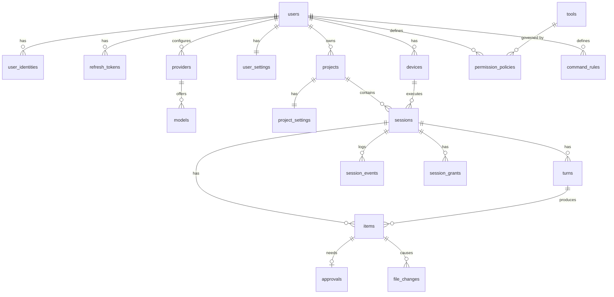

# Pointer: Data Model

PostgreSQL schema of the backend. Concepts are introduced in [02-architecture.md](02-architecture.md#3-key-concepts), wire formats in [03-protocol.md](03-protocol.md).

## 1. Conventions

- Table and column names are `snake_case`, tables in plural.
- Primary keys are `uuid` values of version 7 (time-ordered), generated by the application.
- Timestamps are `timestamptz` named `*_at`. Every table has `created_at`; mutable tables also have `updated_at`.
- Enumerations are `text` columns with `CHECK` constraints, mirroring the protocol values.
- Type-specific or evolving structures are `jsonb` (item payloads, event payloads, settings). Anything used for filtering, joining or uniqueness is a real column.
- Every user-owned row is reachable from `user_id`, and every query is scoped by it.
- Deletion is hard with `ON DELETE CASCADE` down the ownership tree. Archiving is a timestamp column.
- Schema changes are Flyway migrations in `backend/src/main/resources/db/migration`, named `V<n>__<description>.sql`. Built-in tools are seeded by migrations.
- Requires PostgreSQL 16+ with the `vector` extension (used from the RAG milestone) and `citext`.

## 2. Overview

## 3. Accounts

### `users`

| Column | Type | Notes |
|---|---|---|
| `id` | uuid | PK |
| `email` | citext | Unique, required; GitHub accounts use the verified primary email ([ADR 0008](adr/0008-github-sign-in-loopback-redirect.md)) |
| `password_hash` | text | Nullable for accounts without a password |
| `display_name` | text | |
| `locale` | text | `en`, `ru`; default `en` |
| `disabled_at` | timestamptz | Nullable |
| `created_at`, `updated_at` | timestamptz | |

### `user_identities`

External identities linked to a user (AUTH-3, AUTH-4).

| Column | Type | Notes |
|---|---|---|
| `id` | uuid | PK |
| `user_id` | uuid | FK `users` |
| `provider` | text | `github` |
| `provider_user_id` | text | Stable id at the provider |
| `provider_login` | text | |
| `access_token_encrypted` | bytea | Nullable; kept for repository access later |
| `scopes` | text | Granted scopes |
| `created_at`, `updated_at` | timestamptz | |

Unique: (`provider`, `provider_user_id`), (`user_id`, `provider`).

### `refresh_tokens`

| Column | Type | Notes |
|---|---|---|
| `id` | uuid | PK |
| `user_id` | uuid | FK `users` |
| `device_id` | uuid | FK `devices`, nullable |
| `family_id` | uuid | All rotations of one sign-in share a family; reuse of a rotated token revokes the family |
| `token_hash` | text | Unique; SHA-256 of the opaque token |
| `expires_at` | timestamptz | |
| `rotated_at` | timestamptz | Nullable |
| `revoked_at` | timestamptz | Nullable |
| `created_at` | timestamptz | |

### `devices`

| Column | Type | Notes |
|---|---|---|
| `id` | uuid | PK; generated by the client on first launch |
| `user_id` | uuid | FK `users` |
| `name` | text | Editable |
| `platform` | jsonb | OS, version, shell from `hello` |
| `client_version` | text | |
| `last_seen_at` | timestamptz | |
| `revoked_at` | timestamptz | Nullable |
| `created_at`, `updated_at` | timestamptz | |

Connection presence is kept in memory, not in the database.

### `user_settings`

| Column | Type | Notes |
|---|---|---|
| `user_id` | uuid | PK, FK `users` |
| `global_instructions` | text | PROJ-4 |
| `default_model_id` | uuid | FK `models`, nullable, `ON DELETE SET NULL` |
| `embedding_model_id` | uuid | FK `models`, nullable, `ON DELETE SET NULL`; model used for semantic indexes (CTX-7) |
| `preferences` | jsonb | Theme, notification and UI preferences |
| `updated_at` | timestamptz | |

### `slash_commands`

User-defined slash commands (UI-7). The client expands `/name arguments` into the prompt before sending; `$ARGUMENTS` in the prompt is replaced with the arguments, otherwise they are appended.

| Column | Type | Notes |
|---|---|---|
| `id` | uuid | PK |
| `user_id` | uuid | FK `users` |
| `name` | text | `[a-z0-9][a-z0-9-]{0,39}` |
| `description` | text | Shown in the composer suggestions |
| `prompt` | text | |
| `created_at`, `updated_at` | timestamptz | |

Unique: (`user_id`, `name`).

## 4. Providers and models

### `providers`

| Column | Type | Notes |
|---|---|---|
| `id` | uuid | PK |
| `user_id` | uuid | FK `users` |
| `name` | text | |
| `adapter` | text | `openai_compatible`; more values for specialized adapters (PROV-8) |
| `base_url` | text | |
| `api_key_encrypted` | bytea | Nullable; AES-GCM, nonce prefixed |
| `api_key_hint` | text | Last 4 characters, for display |
| `is_local` | boolean | Requests go through the relay (PROV-2) |
| `created_at`, `updated_at` | timestamptz | |

### `models`

| Column | Type | Notes |
|---|---|---|
| `id` | uuid | PK |
| `provider_id` | uuid | FK `providers` |
| `model_key` | text | Model id at the provider, for example `gpt-5` |
| `display_name` | text | |
| `context_window` | integer | Nullable until known (PROV-6) |
| `max_output_tokens` | integer | Nullable |
| `supports_tools` | boolean | Default true |
| `supports_vision` | boolean | Default false |
| `input_price_per_mtok` | numeric(12,6) | Nullable (CTX-6) |
| `output_price_per_mtok` | numeric(12,6) | Nullable |
| `source` | text | `discovered`, `manual` |
| `enabled` | boolean | |
| `created_at`, `updated_at` | timestamptz | |

Unique: (`provider_id`, `model_key`).

## 5. Projects and permissions

### `projects`

| Column | Type | Notes |
|---|---|---|
| `id` | uuid | PK |
| `user_id` | uuid | FK `users` |
| `name` | text | Defaults to the folder name |
| `archived_at` | timestamptz | Nullable |
| `created_at`, `updated_at` | timestamptz | |

Local paths are stored only on devices.

### `project_settings`

| Column | Type | Notes |
|---|---|---|
| `project_id` | uuid | PK, FK `projects` |
| `default_model_id` | uuid | FK `models`, nullable |
| `preferences` | jsonb | |
| `updated_at` | timestamptz | |

### `tools`

The tool registry (TOOL-8).

| Column | Type | Notes |
|---|---|---|
| `id` | uuid | PK |
| `name` | text | Name the model sees |
| `description` | text | |
| `parameters_schema` | jsonb | JSON Schema of arguments |
| `kind` | text | `read`, `write`, `execute` |
| `operation` | text | Executor operation to invoke |
| `modes` | text[] | Modes where the tool is available |
| `default_policy` | text | `allow`, `ask`, `deny` |
| `source` | text | `builtin`, `mcp` (reported by a device, see [ADR 0010](adr/0010-mcp-servers-on-the-device.md)), later `custom` |
| `mcp_server`, `mcp_tool` | text | Original server and tool names of an MCP tool, null otherwise |
| `owner_user_id` | uuid | Null for built-in tools |
| `project_id` | uuid | Null unless a project-scoped custom tool |
| `version` | integer | |
| `enabled` | boolean | |
| `created_at`, `updated_at` | timestamptz | |

Unique: (`name`, `owner_user_id`, `project_id`) with `NULLS NOT DISTINCT`.

### `permission_policies`

Overrides of a tool's default policy (PERM-1, PERM-5).

| Column | Type | Notes |
|---|---|---|
| `id` | uuid | PK |
| `user_id` | uuid | FK `users` |
| `project_id` | uuid | FK `projects`, null for global |
| `tool_id` | uuid | FK `tools` |
| `policy` | text | `allow`, `ask`, `deny` |
| `created_at`, `updated_at` | timestamptz | |

Unique: (`user_id`, `project_id`, `tool_id`) with `NULLS NOT DISTINCT`.

### `command_rules`

Prefix rules for `run_command` (PERM-4).

| Column | Type | Notes |
|---|---|---|
| `id` | uuid | PK |
| `user_id` | uuid | FK `users` |
| `project_id` | uuid | FK `projects`, null for global |
| `prefix` | text | Matched against the normalized command |
| `policy` | text | `allow`, `ask`, `deny` |
| `created_at` | timestamptz | |

## 6. Sessions

### `sessions`

| Column | Type | Notes |
|---|---|---|
| `id` | uuid | PK |
| `user_id` | uuid | FK `users`; denormalized for scoping |
| `project_id` | uuid | FK `projects` |
| `executor_device_id` | uuid | FK `devices` |
| `title` | text | |
| `title_generated` | boolean | False once the user renames |
| `mode` | text | `ask`, `plan`, `agent` |
| `model_id` | uuid | FK `models`, `ON DELETE SET NULL` |
| `status` | text | `idle`, `running`, `waiting_for_approval`, `waiting_for_executor`, `error` |
| `auto_approve` | boolean | PERM-6 |
| `last_seq` | bigint | Last event sequence number |
| `worktree_branch` | text | Nullable; branch of the session worktree ([ADR 0011](adr/0011-session-worktrees.md)) |
| `worktree_base_branch` | text | Branch the worktree was created from and merges into |
| `worktree_state` | text | `active`, `merged`, `discarded`; null for regular sessions |
| `context_tokens` | integer | Current context size |
| `total_input_tokens` | bigint | |
| `total_output_tokens` | bigint | |
| `estimated_cost` | numeric(14,6) | Sum of call costs from model prices at the time of each call; null until a priced model is used (CTX-6) |
| `archived_at` | timestamptz | Nullable |
| `created_at`, `updated_at` | timestamptz | |

Index: (`project_id`, `updated_at` desc).

### `turns`

| Column | Type | Notes |
|---|---|---|
| `id` | uuid | PK |
| `session_id` | uuid | FK `sessions` |
| `number` | integer | 1, 2, 3 within the session |
| `kind` | text | `message` or `compaction` |
| `mode` | text | Mode at turn start |
| `model_id` | uuid | FK `models`, nullable |
| `status` | text | `running`, `completed`, `cancelled`, `failed`, `step_limit`, `interrupted` |
| `error` | jsonb | Nullable |
| `input_tokens`, `output_tokens` | bigint | |
| `idempotency_key` | text | From `POST /messages`, nullable |
| `started_at`, `completed_at` | timestamptz | |
| `rewound_at` | timestamptz | Set when the user rewinds the session to this turn or an earlier one; the turn's items are then hidden from history and context |

Unique: (`session_id`, `number`), (`session_id`, `idempotency_key`).

### `items`

The conversation as the model sees it.

| Column | Type | Notes |
|---|---|---|
| `id` | uuid | PK |
| `session_id` | uuid | FK `sessions` |
| `turn_id` | uuid | FK `turns`, nullable for items queued between turns |
| `position` | bigint | Order within the session |
| `type` | text | `user_message`, `assistant_message`, `reasoning`, `tool_call`, `plan`, `compaction_summary` |
| `status` | text | `in_progress`, `completed`, `failed`, `cancelled` |
| `payload` | jsonb | Type-specific fields from [protocol 5.2](03-protocol.md#52-items) |
| `created_at`, `completed_at` | timestamptz | |

Unique: (`session_id`, `position`). Context assembly reads items from the latest `compaction_summary` onward.

Tool call payload keeps the provider's call id (`providerCallId`) so results can be paired with calls when the history is sent back to the model.

### `approvals`

| Column | Type | Notes |
|---|---|---|
| `id` | uuid | PK |
| `session_id` | uuid | FK `sessions` |
| `item_id` | uuid | FK `items`, unique |
| `preview` | jsonb | Diff or command preview |
| `status` | text | `pending`, `approved`, `denied`, `cancelled` |
| `scope` | text | `once`, `session`; nullable until resolved |
| `message` | text | Optional message to the agent on denial |
| `created_at`, `resolved_at` | timestamptz | |

### `session_grants`

"Allow for this session" answers (PERM-3).

| Column | Type | Notes |
|---|---|---|
| `id` | uuid | PK |
| `session_id` | uuid | FK `sessions` |
| `tool_id` | uuid | FK `tools` |
| `command_prefix` | text | Nullable; set for `run_command` grants |
| `created_at` | timestamptz | |

### `session_events`

The replayable event log ([protocol 4.4](03-protocol.md#44-sessionevent-server--client)).

| Column | Type | Notes |
|---|---|---|
| `session_id` | uuid | PK part, FK `sessions` |
| `seq` | bigint | PK part |
| `kind` | text | Event kind |
| `payload` | jsonb | |
| `occurred_at` | timestamptz | |

`seq` is allocated by incrementing `sessions.last_seq` in the same transaction that writes the event, which keeps it gap-free.

## 7. Review

### `attachments`

Images attached to user messages (SESS-11). Messages reference them by id; the context sends them to vision models as `image_url` data URLs and replaces them with a short note for other models.

| Column | Type | Notes |
|---|---|---|
| `id` | uuid | PK |
| `session_id` | uuid | FK `sessions`, `ON DELETE CASCADE` |
| `media_type` | text | `image/png`, `image/jpeg`, `image/gif`, `image/webp` |
| `size_bytes` | integer | At most 5 MB |
| `data` | bytea | |
| `created_at` | timestamptz | |

### `file_changes`

| Column | Type | Notes |
|---|---|---|
| `id` | uuid | PK |
| `session_id` | uuid | FK `sessions` |
| `turn_id` | uuid | FK `turns` |
| `item_id` | uuid | FK `items` |
| `path` | text | Relative to the project root |
| `change_kind` | text | `created`, `modified`, `deleted` |
| `before_content` | text | Null for created files |
| `after_content` | text | Null for deleted files |
| `lines_added`, `lines_removed` | integer | |
| `reverted_at` | timestamptz | Nullable |
| `created_at` | timestamptz | |

Index: (`session_id`, `path`). Content is stored only for text files up to 1 MiB; larger or binary files are recorded without content and cannot be reverted.

### Semantic index

Tables of the `rag` module ([ADR 0013](adr/0013-semantic-code-index.md)), accessed with plain SQL because of the `vector` type.

`index_states`: one row per indexed project.

| Column | Type | Notes |
|---|---|---|
| `project_id` | uuid | PK, FK `projects` |
| `user_id` | uuid | FK `users`, whose provider computes embeddings |
| `embedding_model_id` | uuid | FK `models`, `ON DELETE SET NULL` |
| `embedding_model_key` | text | Model key at indexing time, for display |
| `dimensions` | integer | Vector length returned by the model |
| `status` | text | `indexing`, `ready`, `failed` |
| `files_total`, `files_done` | integer | Progress of the current pass over changed files |
| `file_count`, `chunk_count` | integer | Size of the index |
| `error` | text | Last failure |
| `indexed_at`, `updated_at` | timestamptz | |

`indexed_files`: (`project_id`, `path`) PK, `content_hash` (SHA-256 reported by the device).

`code_chunks`: `id`, `project_id`, `path`, `symbol` (nullable, e.g. `SessionService.create`), `kind` (syntax node kind, `group` or `lines`), `start_line`, `end_line`, `content`, `embedding vector` without a fixed dimension. Index on (`project_id`, `path`); search is an exact cosine scan per project.

## 8. Planned for highlight features

Sketched here so the core schema leaves room for them. Final definitions come with their milestones.

| Table | Feature | Purpose |
|---|---|---|
| `custom_tool_implementations` | Custom tools | Implementation kind and body for `tools` rows with `source = 'custom'`, plus the proposing session |
| `telegram_links` | Telegram | `user_id`, `chat_id`, link code, linked time |
| `remote_workspaces` | Remote execution | Container id, repository, branch, status for sessions on the container executor |
