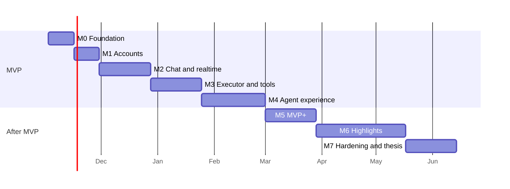

# Pointer: Roadmap

Planning horizon: November 2026 to the defense in summer 2027.
Requirement ids refer to [01-requirements.md](01-requirements.md).

## 1. Approach

- **Vertical slices.** Each milestone ends with something usable end to end across backend, core and UI, not with a finished layer.
- **Risky parts first.** The streaming agent loop, the executor round trip and the relay are the core of the product and the main technical risks, so they come before polish.
- **Dogfooding early.** From M4 on, Pointer is used to develop Pointer. Real use decides what to fix next.
- **Buffer.** Dates are targets with slack built into the later phases. Highlights are ordered by value, so dropping the last one does not hurt the defense.

## 2. Timeline

| Milestone | Target end | Outcome | Status |
|---|---|---|---|
| M0 Foundation | mid November | Projects build, run and pass CI | Implemented |
| M1 Accounts | end of November | Sign-in from the desktop app | Implemented |
| M2 Chat and realtime | end of December | Streaming chat with any OpenAI-compatible or local model | Implemented |
| M3 Executor and tools | end of January | The agent reads, edits and runs commands with approvals | Implemented |
| M4 Agent experience | early March | **MVP v0.1**, used daily for Pointer development | Implemented; the week of daily use is tracked by the author |
| M5 MVP+ | end of March | Checkpoints, worktrees, MCP, terminal | Implemented (November 2026) |
| M6 Highlights | mid May | RAG, custom tools, Telegram, remote execution | Implemented (November 2026) |
| M7 Hardening and thesis | mid June | Cloud deployment, measurements, thesis text | Planned |

Development runs ahead of the targets: M0 to M5 were implemented by early November 2026. M6 was implemented in the order listed below: RAG, agent-proposed custom tools (TOOL-13), Telegram remote control and remote execution. "Implemented" means the features are built and covered by tests; done criteria that require a period of real use are confirmed separately.

## 3. Milestones

### M0 Foundation

- Backend: Gradle project, Spring Boot 4 on Java 25, Flyway, Testcontainers for integration tests, health endpoint.
- Desktop: Tauri 2 project with React, TypeScript, Vite, Tailwind, shadcn/ui, i18next with `en` and `ru`.
- Infra: Docker Compose with PostgreSQL and pgvector.
- Tooling: formatters and linters (Spotless for Java, ESLint and Prettier, rustfmt and Clippy), GitHub Actions building and testing all three parts.
- OpenAPI generation on the backend and TypeScript type generation on the desktop.

Done when a fresh clone builds and tests with one command per part and CI is green.

### M1 Accounts

- Registration, sign-in, refresh rotation, sign-out, password change (AUTH-1, 2, 5, 6, 7).
- GitHub OAuth with PKCE and a loopback redirect, account linking (AUTH-3, 4).
- Desktop: sign-in screens, refresh token in Windows Credential Manager, device registration.
- Settings screen skeleton with language and theme switching (UI-1, UI-2).

Done when the user signs in with either method, restarts the app and is still signed in.

### M2 Chat and realtime

- Providers and models: CRUD, key encryption, model discovery, connection test (PROV-1 to 7).
- OpenAI-compatible streaming client with tool-call parsing, tested against recorded streams of several providers.
- WebSocket gateway: handshake, connection registry, reconnect, subscriptions with replay (protocol sections 1 to 4).
- Sessions, turns, items, event log; a tool-less agent loop; cancellation; title generation (SESS-1 to 7, 9, 10).
- LLM relay in the core for local providers (protocol section 8).
- UI: project list, session list, conversation view with Markdown and streaming, composer, model picker (UI-3).

Done when a conversation streams from both a remote provider and a local Ollama model, and survives a client restart and a dropped connection.

### M3 Executor and tools

- Projects and device mapping (PROJ-1, 2, 5).
- Executor in the core with the path guard; read-only tools first: `list_directory`, `read_file`, `glob`, `grep` (TOOL-1 to 4, 9, 10). Ask mode (MODE-1).
- Tool registry seeded by migrations (TOOL-8).
- Write tools and `run_command` with streaming output, timeouts and process-tree cancellation (TOOL-5 to 7).
- Permission policies, command rules, approvals with dry-run diff previews, session grants, auto-approve (PERM-1 to 6). Agent mode (MODE-3).
- Executor disconnect handling (SESS-8).

Done when the agent completes a small multi-file change in a real project, with every write approved through the UI.

### M4 Agent experience

- Plan mode with plan approval, mode switching (MODE-2, 4).
- Context assembly with project rules and global instructions, `@`-mentions, usage display, automatic and manual compaction (PROJ-3, 4, CTX-1 to 5).
- Review: file change records, changed-files panel, diff viewer, revert per file (REV-1 to 3).
- Messages queued during a running turn (SESS-6).
- Notifications and keyboard shortcuts (UI-4, 5).
- Hardening: error states, empty states, long-session performance, installer build.

Done when MVP v0.1 is installed from the installer and used for a week of Pointer development without falling back to another tool for routine tasks.

### M5 MVP+

Ordered by value; the last items may move after the highlights if time is short.

1. Checkpoints and rollback to a turn (REV-4).
2. Integrated terminal panel (UI-6).
3. MCP client (TOOL-12).
4. Parallel sessions in git worktrees (REV-5).
5. Slash commands, `web_fetch`, cost estimates, image attachments (UI-7, TOOL-11, CTX-6, SESS-11).

### M6 Highlights

Ordered by value for the defense.

1. **RAG with AST chunking** (CTX-7, TOOL-14): tree-sitter chunking in the core, embeddings through an OpenAI-compatible `/embeddings` endpoint, pgvector index, incremental reindexing, `semantic_search` tool. Implemented; the evaluation comparing answers with and without RAG is part of the M7 measurements.
2. **Agent-proposed custom tools** (TOOL-13): scripts for an interpreter reported by the device, proposed through `propose_tool` and approved like a tool call, stored with versions and rollback, executed on the device as `custom_tool.run` ([ADR 0014](adr/0014-agent-proposed-custom-tools.md)). Implemented.
3. **Telegram remote control** (REM-1, 2): account linking through a one-time deep link, session list and new sessions, sending messages, a live progress message, final answers, inline approval and plan buttons, long polling of the Bot API ([ADR 0015](adr/0015-telegram-remote-control.md)). Implemented and checked manually with a real bot: linking, progress, approvals by button, by reply and from the desktop, plans, /stop, /new, answers from other sessions, failures and the Russian locale.
4. **Remote execution** (REM-3): a per-session Docker container with the headless runner, cloning the project's GitHub repository into a session branch, auto-approved tools inside the container, a commit and push after each turn that changed files, pull requests from the desktop, server sessions from Telegram `/new` when no computer is online ([ADR 0016](adr/0016-remote-execution-in-containers.md)). Implemented and checked manually against a real GitHub repository on the local Docker Desktop: clone into the session branch, auto-approved file edit and command, push after the turn.

### M7 Hardening and thesis

- Deploy the backend to a cloud server with TLS.
- Remote execution on the server: Docker access through a socket proxy limited to container and volume calls, a separate network for runner containers that reaches only the backend, the runner image published to GHCR by CI, and a limit on concurrently running containers sized to the server.
- Measurements for the thesis: time to first token overhead (NFR-2), reconnect behaviour (NFR-3), RAG evaluation results.
- RAG findings from the first end-to-end run with Ollama `nomic-embed-text` (CPU): indexing this repository (289 files, 933 chunks) took about 5.5 minutes, dominated by the model; retrieval was accurate for most code questions but missed `SecretCipher` for "encrypt provider API keys". Candidates to evaluate: model-specific query and document prefixes (`search_query:` / `search_document:`), hybrid lexical and vector ranking.
- Bug fixing from dogfooding, test coverage of core backend logic (NFR-10).
- Known issue: turns interrupted by a backend restart are marked `interrupted` in the database without session events, so open clients show them as running until the session is reloaded.
- Thesis write-up and defense materials.

## 4. Risks

| Risk | Impact | Mitigation |
|---|---|---|
| "OpenAI-compatible" providers differ in streaming tool calls and usage reporting | Broken agent turns on some providers | Recorded-stream tests per provider, per-model flags, defensive parser |
| Local models handle tool calling poorly | Weak agent behaviour with local models | Document recommended models; the product still works, quality depends on the model |
| Rust is the least familiar language in the stack | Slower progress in the core | Keep the core small and focused; most logic lives on the backend |
| Scope creep from MVP+ and highlights | MVP not stable before highlights | MVP done criteria are fixed; MVP+ items are cut before highlights |
| Windows process management (killing trees, encoding, PowerShell quirks) | Hanging or orphaned commands | Job objects from the start, UTF-8 output, integration tests on Windows CI runners |
| Single-instance backend | Running turns lost on restart | Turns marked `interrupted`, history intact; acceptable for the project scale |

## 5. Open decisions

To be settled as ADRs when the related milestone starts.

| Decision | Milestone |
|---|---|
| Monaco Editor or CodeMirror 6 for code and diff viewing | M3 |
| Token estimation library for providers without usage data | M2 |
| Compaction strategy details (threshold, what to keep verbatim): [ADR 0009](adr/0009-context-compaction-and-plan-approval.md) | M4 |
| MCP transports to support (stdio, streamable HTTP) and where MCP servers run: [ADR 0010](adr/0010-mcp-servers-on-the-device.md) | M5 |
| Embedding model defaults and chunk size for RAG: [ADR 0013](adr/0013-semantic-code-index.md) | M6 |
| Container runtime and isolation for remote execution: [ADR 0016](adr/0016-remote-execution-in-containers.md) | M6 |
| Where session worktrees live and how they merge: [ADR 0011](adr/0011-session-worktrees.md) | M5 |
