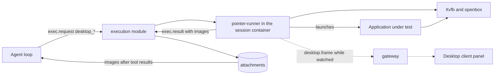

# F7. GUI testing sandbox

Status: Approved · Requirement ids: GUI-1 to GUI-12 · Depends on: remote execution in containers ([ADR 0016](../../adr/0016-remote-execution-in-containers.md)), image attachments, the vision flag of models ([F3](../f3-model-routing.md)), result masking ([F5](../f5-cache-aware-context.md)). Optional: trajectory signals ([F6](../f6-trajectory-escalation.md)).

The spec is split into several files, each one readable on its own:

| File | Contents |
|---|---|
| [README.md](README.md) | Goal, scope, requirements, design summary, phases, open questions (this file) |
| [container.md](container.md) | Image, virtual display, process model, resources, isolation, limits |
| [tools-and-protocol.md](tools-and-protocol.md) | Model-facing tools, executor operations, images in results, live view messages, data model |
| [agent-and-context.md](agent-and-context.md) | Vision gating, how screenshots enter the context, image masking, prompt guidance, security |
| [desktop-ui.md](desktop-ui.md) | Conversation rendering, the live view panel |
| [tests-and-metrics.md](tests-and-metrics.md) | Tests per phase, benchmark design, thesis metrics |
| [stage-2-local-sessions.md](stage-2-local-sessions.md) | Sandbox for sessions that run on the user's computer (design sketch, not scheduled) |

## Goal

The agent can run the application it is working on inside the session's container, look at its screen, click, type and press keys, and judge from what it sees whether the change works. The screen is a virtual display inside the container with its own pointer and keyboard focus, so nothing touches the user's screen and the user keeps working. The user can watch the display live while a turn runs.

Computer-use features of desktop assistants run on the user's own display. On macOS some of them work in the background; on Windows, where Pointer's users are, input injection shares one cursor and one keyboard focus with the user. A container with a virtual display avoids the conflict by construction and is reproducible. The thesis compares these isolation levels and measures how well models do the work (see [tests-and-metrics.md](tests-and-metrics.md)).

## Scope

In scope for stage 1:

- Server sessions only: the display lives in the session's runner container ([ADR 0016](../../adr/0016-remote-execution-in-containers.md)), next to the checkout, the toolchains and the auto-approved command execution that already exist there.
- Any application that runs on Linux under X11: web applications in a browser, Electron, Tauri (WebKitGTK), Qt, GTK, Java Swing and JavaFX, Flutter desktop.
- Pixel control (screenshot, coordinates) plus an accessibility tree where the toolkit provides one.
- Screenshots in the conversation and a read-only live view.

Out of scope for stage 1:

- Sessions that run on the user's computer. They get a sandbox in stage 2 ([stage-2-local-sessions.md](stage-2-local-sessions.md)).
- User takeover of the display. The live view is read-only; a VNC-based takeover is a possible later phase.
- Windows and macOS applications, GPU rendering, audio, camera and USB. A Linux container cannot run them. A passing test shows that the logic and the layout work on Linux with the Linux rendering engine (for Tauri, WebKitGTK instead of WebView2), not that the Windows build looks identical.
- Controlling the user's real desktop.

## Builds on

- Runner: `pointer-runner` and the shared `pointer-executor` crate ([ADR 0016](../../adr/0016-remote-execution-in-containers.md)), the per-session container started by the `container` module, the image in `infra/runner/Dockerfile` (targets `slim` and `full`).
- Tools: the `tools` table, `ToolRegistry.available`, permission policies and auto-approval for server sessions (PERM-6).
- Images: the `attachments` table and `AttachmentService.dataUrl`, `ChatMessage.imageUrls`, `ContextAssembler.userMessage` (images only for models with vision), `RoutedClient` and `PrefixFingerprint` that already account for images.
- Context: `ResultMask` and `MaskPolicy` of F5, append-only context ([ADR 0024](../../adr/0024-append-only-context.md)), cache-aware compaction ([ADR 0025](../../adr/0025-cache-aware-compaction.md)).
- Gateway: the runner's WebSocket connection and the `exec.*` messages ([03-protocol.md](../../03-protocol.md) section 6).

## Requirements

| Id | Requirement |
|---|---|
| GUI-1 | The runner image has a graphics variant. A runner started from it reports the device capability `desktop`; a runner without the display stack does not. |
| GUI-2 | The agent can start a virtual display, launch and stop long-running GUI processes on it and take screenshots of it. One display per session container. |
| GUI-3 | The agent can move the pointer, click, double-click, drag, scroll, type text and press keys. Every input operation returns a screenshot taken after the interface settled, unless the call asks otherwise. |
| GUI-4 | Desktop tools are offered only in Agent mode, only when the executor reports `desktop` and only when the step model supports vision. They follow the usual permission policies and are auto-approved in server sessions. |
| GUI-5 | Screenshots are stored as session attachments, shown in the conversation and sent to the model as images right after the tool results of the step. |
| GUI-6 | Old screenshots are replaced by a placeholder in the model's view, in blocks so that the prompt prefix stays stable between moves, under every context strategy. Originals stay in the database and the client. |
| GUI-7 | While a turn runs the user can watch the display live and read-only. Frames are produced only while someone watches. |
| GUI-8 | The agent can read an accessibility tree of the display and click an element by its id. Applications without a tree are controlled by pixels only. |
| GUI-9 | The display and its processes stop with the container. Resolution, memory, shared memory and image sizes are bounded. |
| GUI-10 | A benchmark measures success rate, steps, duration, tokens and cost of GUI tasks per model, click accuracy, and the effect of image masking and of the accessibility tree. |
| GUI-11 | (Stage 2) A session that runs on the user's computer can get a sandbox container with the same desktop tools. |
| GUI-12 | (Stage 2) The code under test reaches the sandbox with the user's consent, and the sandbox is bounded and cleaned up like a runner container. |

## Design summary

Key decisions:

1. **No new container and no new service.** The display stack and the input and capture operations are added to the runner. The agent loop does not know where tools run ([ADR 0001](../../adr/0001-server-side-agent-orchestration.md)); it sees new tools whose operations only a desktop-capable device performs.
2. **External X11 tools, not in-process input.** The runner starts `Xvfb` and `openbox`, injects input with `xdotool`, captures with `scrot` and encodes with the `image` crate. Each is a small, well-known binary; the runner stays a process manager.
3. **The screenshot has the display's resolution.** The default display is 1280x800, so the coordinates the model reads from the screenshot are the coordinates the runner clicks. No scaling arithmetic.
4. **Images follow the tool results as a user message.** OpenAI-compatible tool messages carry text only, so the screenshots of a step are appended as one synthetic user message after the step's tool results. Details in [agent-and-context.md](agent-and-context.md).
5. **Screenshots are the main cost, so they are masked by their own policy.** The newest few stay, older ones become placeholders, moving in blocks like F5's result masking.
6. **Live view by frames through the gateway, not VNC.** The runner sends JPEG frames over its existing gateway connection only while a client watches. No port is opened in the container, nothing new needs authentication, and read-only is the only mode that exists. A VNC server remains the way to add takeover later.

## Phases

Each phase ships on its own and leaves the system working. Phases are numbered `1.x`; stage 2 phases are in [stage-2-local-sessions.md](stage-2-local-sessions.md).

1. **1.1 Display in the runner (GUI-1, GUI-2, GUI-3, GUI-9).** The `gui` target of the image, the `desktop` module in `pointer-executor`, the operations `desktop_start`, `desktop_launch`, `desktop_stop`, `desktop_screenshot`, `desktop_move`, `desktop_click`, `desktop_drag`, `desktop_scroll`, `desktop_type`, `desktop_key`, `desktop_wait`, the capability in `hello`, the shared memory size in the container spec. Verified by runner tests inside the image against a fixture GUI application. No backend or client change yet. Decides the default image and the memory limit from measurements ([container.md](container.md)).
2. **1.2 Tools, images and the model (GUI-4, GUI-5).** Tool rows, capability filtering in `ToolRegistry`, images stored as attachments, the `images` field of `tool_call` items, the synthetic user message, vision gating, tool descriptions, protocol and data model docs, ADR 0027, a thumbnail of the screenshot in the conversation. After this phase an agent in a server session can test a GUI application end to end; the cost control and the live view are still missing.
3. **1.3 Image masking (GUI-6).** `keep-images` and block alignment on the F5 mask arithmetic, image token estimate, property test of the append-only invariant with images, ADR for the amendment of ADR 0024.
4. **1.4 Live view (GUI-7).** `desktop.watch`, `desktop.stream`, `desktop.frame`, watcher counting in the backend, frame producer in the runner, the Desktop panel in the client.
5. **1.5 Accessibility tree (GUI-8).** AT-SPI reader in the runner, `desktop_tree`, `elementId` for `desktop_click`, toolkit environment variables and the browser wrapper in the image, a coverage table per toolkit measured on the fixture applications.
6. **1.6 Benchmark and defaults (GUI-10).** The harness in `infra/bench/desktop/`, fixture applications and tasks, runs per model, defaults for `keep-images`, the display size and the settle delay, results in `docs/benchmarks/desktop.md`.

Stage 2 starts only after phase 1.6 shows the feature works well enough to justify it.

## Open questions

- Whether the `gui` target replaces `full` as the default runner image or stays an option chosen at session creation. Decided in phase 1.1 from the measured image size and the memory of an idle display.
- Which of the test providers' models both support vision and click accurately enough. Unknown until phase 1.6; the feature is built to work with any vision model and report the differences.
- Whether Telegram should receive a screenshot with the final answer of a GUI turn. Deferred: the Telegram bot does not show images today.
- Retention of screenshots. They are stored as attachments and removed with the session; a long GUI session can store hundreds of megabytes. Phase 1.3 measures the growth and decides whether to cap by count or age.
