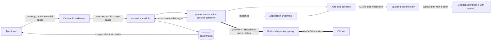

# F7. GUI testing sandbox

Status: Approved · Requirement ids: GUI-1 to GUI-13 · Depends on: remote execution in containers ([ADR 0016](../../adr/0016-remote-execution-in-containers.md)), image attachments, the vision flag of models ([F3](../f3-model-routing.md)), result masking ([F5](../f5-cache-aware-context.md)), the tiers and pre-checks of escalation ([F6](../f6-trajectory-escalation.md)).

The spec is split into several files, each one readable on its own:

| File | Contents |
|---|---|
| [README.md](README.md) | Goal, scope, requirements, design summary, phases, open questions (this file) |
| [container.md](container.md) | Image, privileges, repository proxy, virtual display, live view stack, process model, resources, isolation, limits |
| [tools-and-protocol.md](tools-and-protocol.md) | Model-facing tools, coordinate spaces, executor operations, images in results, capabilities, data model, live view endpoints |
| [agent-and-context.md](agent-and-context.md) | Vision gating, coordinates per model, how screenshots enter the context, image masking, prompt guidance, security |
| [desktop-ui.md](desktop-ui.md) | Conversation rendering, the live view panel, the model setting |
| [tests-and-metrics.md](tests-and-metrics.md) | Tests per phase, benchmark design, thesis metrics |
| [stage-2-local-sessions.md](stage-2-local-sessions.md) | Sandbox for sessions that run on the user's computer (design sketch, not scheduled) |

## Goal

The agent can run the application it is working on inside the session's container, look at its screen, click, type and press keys, and judge from what it sees whether the change works. The screen is a virtual display inside the container with its own pointer and keyboard focus, so nothing touches the user's screen and the user keeps working. The user can watch the display live while a turn runs.

Computer-use features of desktop assistants run on the user's own display. On macOS some of them work in the background; on Windows, where Pointer's users are, input injection shares one cursor and one keyboard focus with the user. A container with a virtual display avoids the conflict by construction and is reproducible. The thesis compares these isolation levels and measures how well models do the work (see [tests-and-metrics.md](tests-and-metrics.md)).

## Scope

In scope for stage 1:

- Server sessions only: the display lives in the session's runner container ([ADR 0016](../../adr/0016-remote-execution-in-containers.md)), next to the checkout, the toolchains and the auto-approved command execution that already exist there.
- Any application that runs on Linux under X11: web applications in a browser, Electron, Tauri (WebKitGTK), Qt, GTK, Java Swing and JavaFX, Flutter desktop.
- Pixel control (screenshot, coordinates) plus an accessibility tree where the toolkit provides one.
- Screenshots in the conversation and a read-only live view.
- Root inside runner containers, so the agent can install the system packages an application needs, and a repository proxy on the backend, so the GitHub token no longer enters the container.

Out of scope for stage 1:

- Sessions that run on the user's computer. They get a sandbox in stage 2 ([stage-2-local-sessions.md](stage-2-local-sessions.md)).
- User takeover of the display. The live view is read-only; takeover would reuse the same VNC stream with input enabled and is a possible later phase.
- Windows and macOS applications, GPU rendering, audio, camera and USB. A Linux container cannot run them. A passing test shows that the logic and the layout work on Linux with the Linux rendering engine (for Tauri, WebKitGTK instead of WebView2), not that the Windows build looks identical.
- Controlling the user's real desktop.

## Builds on

- Runner: `pointer-runner` and the shared `pointer-executor` crate ([ADR 0016](../../adr/0016-remote-execution-in-containers.md)), the per-session container started by the `container` module (`ContainerRuntime`, `DockerContainerRuntime`, `ContainerSpec`), the image in `infra/runner/Dockerfile` (targets `slim` and `full`), the repository operations `pointer.repo_prepare` and `pointer.repo_publish`.
- Tools: the `tools` table, `ToolRegistry.available`, permission policies and auto-approval for server sessions (PERM-6).
- Images: the `attachments` table and `AttachmentService.dataUrl`, `ChatMessage.imageUrls`, `ContextAssembler.userMessage` (images only for models with vision), `RoutedClient` and `PrefixFingerprint` that already account for images, the `supports_vision` column of `models`.
- Context: `ResultMask` and `MaskPolicy` of F5, `TokenEstimate`, append-only context ([ADR 0024](../../adr/0024-append-only-context.md)), cache-aware compaction ([ADR 0025](../../adr/0025-cache-aware-compaction.md)).
- Escalation: `EscalationController` and its pre-checks ([F6](../f6-trajectory-escalation.md), [ADR 0026](../../adr/0026-trajectory-aware-escalation.md)).
- Gateway: the runner's WebSocket connection and the `exec.*` messages ([03-protocol.md](../../03-protocol.md) section 6).

## Requirements

| Id | Requirement |
|---|---|
| GUI-1 | The runner image has a graphics variant. A runner started from it reports the device capability `desktop`; a runner without the display stack does not. |
| GUI-2 | The agent can start a virtual display, launch and stop long-running GUI processes on it, take screenshots of it and wait for a window or a log line to appear. One display per session container. |
| GUI-3 | The agent can move the pointer, click, double-click, drag, scroll, type text and press keys. Every input operation returns a screenshot taken after the interface settled, unless the call asks otherwise. Coordinates are given in the space of the screenshot the model sees, as pixels or on a 0–1000 grid according to the model's setting, and the backend maps them to the display. |
| GUI-4 | Desktop tools are offered only in Agent mode, only when the executor reports `desktop` and only when the session's step model supports vision. A `fast` tier without vision that calls one escalates the turn instead of running it. They follow the usual permission policies and are auto-approved in server sessions. |
| GUI-5 | Screenshots are stored as session attachments, shown in the conversation and sent to the model as images right after the tool results of the step. |
| GUI-6 | Old screenshots are replaced by a placeholder in the model's view, in blocks so that the prompt prefix stays stable between moves, under every context strategy. Originals stay in the database and the client. |
| GUI-7 | While a turn runs the user can watch the display live and read-only through a VNC stream shown by noVNC. The stream is reachable only through the backend, which authorizes the viewer. |
| GUI-8 | The agent can read an accessibility tree of the display and click an element by its id. Applications without a tree are controlled by pixels only. |
| GUI-9 | The display and its processes stop with the container. Resolution, the size of the screenshots sent to the model, their encoded size, memory, shared memory and process count are bounded. |
| GUI-10 | A benchmark measures success rate, steps, duration, tokens and cost of GUI tasks per model, click accuracy per coordinate convention, and the effect of image masking and of the accessibility tree. |
| GUI-11 | (Stage 2) A session that runs on the user's computer can get a sandbox container with the same desktop tools. |
| GUI-12 | (Stage 2) The code under test reaches the sandbox with the user's consent, and the sandbox is bounded and cleaned up like a runner container. |
| GUI-13 | Commands in a runner container run as root with a reduced capability set, so the agent can install system packages. The GitHub token never enters the container: clone and push go through a repository proxy on the backend that allows writes to the session branch only. |

## Design summary

Key decisions:

1. **No new container and no new service.** The display stack and the input and capture operations are added to the runner. The agent loop does not know where tools run ([ADR 0001](../../adr/0001-server-side-agent-orchestration.md)); it sees new tools whose operations only a desktop-capable device performs.
2. **External X11 tools, not in-process input.** The runner starts `Xvfb` and `openbox`, injects input with `xdotool`, captures with `scrot` and encodes and scales with the `image` crate. Each is a small, well-known binary; the runner stays a process manager.
3. **Coordinates in the model's own space, mapped by the backend.** Vision models do not agree on coordinates: some answer in pixels of the image they were given, others (Qwen3-VL, Gemini) on a 0–1000 grid, and providers shrink large images before the model sees them. The screenshot sent to the model is therefore limited to 1280x800 by default, a model has a `coordinate_system` setting (`pixels` or `normalized`), and the backend converts between the model's space and the display's pixels in both directions. The default display is 1280x800, so for a model that answers in pixels the mapping is the identity in the common case. Details in [tools-and-protocol.md](tools-and-protocol.md#coordinate-spaces).
4. **Images follow the tool results as a user message.** OpenAI-compatible tool messages carry text only, so the screenshots of a step are appended as one synthetic user message after the step's tool results. Details in [agent-and-context.md](agent-and-context.md).
5. **Screenshots are the main cost, so they are masked by their own policy.** The newest few stay, older ones become placeholders, moving in blocks like F5's result masking.
6. **Live view through VNC and noVNC.** The container runs `x11vnc` on the display and `websockify` to turn it into a WebSocket; the desktop client shows it with the noVNC library. The user never connects to the container: the backend authorizes a short-lived ticket and relays the WebSocket. The stream is view-only twice over (the client only gets a view-only password, and `x11vnc` runs with `-viewonly`), and the same stream is the base for user takeover if it is added later. Two alternatives were considered. JPEG frames through the gateway were rejected: simpler to secure, but VNC gives smoother video at a lower bandwidth and a ready path to takeover. A reverse tunnel, where the runner dials the backend and carries the RFB bytes over its own outbound WebSocket, needs no listening port and no per-deployment access mode; it costs a bridge in the runner and a rendezvous of two WebSockets in the backend, and stays the fallback if phase 1.4 finds the access modes unworkable on a host. ADR 0027 records this when it is written.
7. **Root in the container, the token outside it.** The container is the sandbox, so the agent gets root inside it with a reduced capability set and can install what an application needs. Root makes every secret in the container readable by the agent, so the one valuable secret, the user's GitHub token, is taken out: the runner clones and pushes through a repository proxy on the backend, which adds the token and accepts writes to the session branch only. This also closes today's leak through git hooks, which inherit the environment that carries the token. Details in [container.md](container.md#privileges-gui-13); an ADR amending [ADR 0016](../../adr/0016-remote-execution-in-containers.md) is written in phase 1.1.

## Phases

Each phase ships on its own and leaves the system working. Phases are numbered `1.x`; stage 2 phases are in [stage-2-local-sessions.md](stage-2-local-sessions.md).

1. **1.1 Privileges and display in the runner (GUI-1, GUI-2, GUI-3, GUI-9, GUI-13).** In this order: the repository proxy and the token removed from the repository operations; root, the capability set and the spec hash that recreates outdated containers; the `gui` target of the image; the `desktop` module in `pointer-executor` with the operations `desktop_start`, `desktop_launch`, `desktop_stop`, `desktop_screenshot`, `desktop_move`, `desktop_click`, `desktop_drag`, `desktop_scroll`, `desktop_type`, `desktop_key`, `desktop_wait`; the capability in `hello`; shared memory and the process limit in the container spec. Verified by runner tests inside the image against fixture GUI applications and by backend tests of the proxy. No change to the agent or the client yet. Decides the default image, the memory and the process limit from measurements ([container.md](container.md)), and writes the ADR amending ADR 0016.
2. **1.2 Tools, images and the model (GUI-4, GUI-5).** Tool rows, persisted capabilities and filtering in `ToolRegistry`, `DesktopCoordinates` and the model's `coordinate_system`, images stored as attachments, the `images` and `marks` fields of `tool_call` items, the synthetic user message, vision gating and the `vision` escalation, tool descriptions, a check of the message order against every test provider, protocol and data model docs, ADR 0027, a thumbnail of the screenshot in the conversation. After this phase an agent in a server session can test a GUI application end to end; the cost control and the live view are still missing.
3. **1.3 Image masking (GUI-6).** `keep-images` and block alignment on the F5 mask arithmetic, image token estimate from dimensions, property test of the append-only invariant with images, ADR for the amendment of ADR 0024.
4. **1.4 Live view (GUI-7).** `x11vnc` and `websockify` started with the display, per-session view credentials, how the backend reaches the container, the ticket endpoint and the WebSocket relay, the Desktop panel with noVNC in the client. The packages are already in the image from phase 1.1, so the image size is measured once.
5. **1.5 Accessibility tree (GUI-8).** AT-SPI reader in the runner, `desktop_tree`, `elementId` for `desktop_click`, the toolkit bridges and environment variables in the image, a coverage table per toolkit measured on the fixture applications.
6. **1.6 Benchmark and defaults (GUI-10).** The harness in `infra/bench/desktop/`, fixture applications and tasks, runs per model, the coordinate convention of each test model, defaults for `keep-images`, the image limit, the display size and the settle delay, results in `docs/benchmarks/desktop.md`.

Stage 2 starts only after phase 1.6 shows the feature works well enough to justify it.

## Open questions

- Whether the `gui` target replaces `full` as the default runner image or stays an option chosen at session creation. Decided in phase 1.1 from the measured image size, the memory of an idle display and the fixed cost of the desktop tool schemas in every request (phase 1.2 counts it).
- Twelve tools or one. Separate tools are easier for models to call correctly; a single `desktop` tool with an `action` argument, in the style of other computer-use tools, costs fewer schema tokens in every request of every server session. Phase 1.2 counts the schema tokens; if the cost matters once `gui` is the default image, phase 1.6 compares both forms on the same tasks.
- How the backend reaches a session container for the stream. In the compose deployment the backend and the runners share the `pointer-runners` network and the container name resolves; in development the backend runs on the host and container addresses are not routable from it, so the stream port is published on `127.0.0.1` instead. Both are supported behind `pointer.container.desktop-access` (`network` or `published`); phase 1.4 confirms them on the real hosts, with the reverse tunnel of key decision 6 as the fallback.
- Which of the test providers' models both support vision and click accurately enough, and which coordinate convention each uses. Unknown until phase 1.6; the feature is built to work with any vision model and report the differences.
- Whether Telegram should receive a screenshot with the final answer of a GUI turn. Deferred: the Telegram bot does not show images today.
- Retention of screenshots. They are stored as attachments and removed with the session; a long GUI session can store hundreds of megabytes. Phase 1.3 measures the growth and decides whether to cap by count or age.
- User namespace remapping for runner containers, so that root in a container is not root on the host after a kernel escape. Not planned for the shared production host in stage 1 (it is a daemon-wide setting); recorded as a hardening step in the ADR of phase 1.1.
