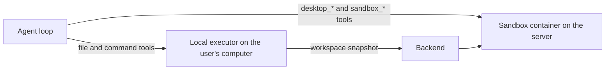

# F7. Stage 2: sandbox for local sessions

Part of [F7](README.md). Covers GUI-11 and GUI-12. Started on 2026-11-26 after phase 1.6; the open questions of the design sketch were answered with the user on that day (see [Decisions](#decisions)).

## Problem

A local session runs its executor on the user's computer, which is a Windows machine in the common case. There is no Linux display there and the stage 1 tools are not offered. The code the agent is changing lives on that computer, not in a server container.

## Direction

A **sandbox** is a second executor for a session: a container started from the `gui` image, with the same `pointer-runner` binary and the `desktop` capability, created by the `container` module on demand, with root and the reduced capability set of stage 1 ([container.md](container.md#privileges-gui-13)). The session keeps its local executor for files and commands; the desktop tools and the sandbox's own tools are routed to the sandbox. A sandbox has no repository access at all: the code arrives by sync, so neither the GitHub token nor the repository proxy is involved.

## Decisions

Taken with the user on 2026-11-26, answering the open questions of the sketch:

1. **The sandbox runs on the backend host.** It reuses the `container` module, the gateway, the live view relay, the container slots and the idle stop of stage 1. The cost: the code is sent to the server, and the sandbox cannot reach services on the user's computer (a local database, a dev server); a project that needs a service starts it inside the sandbox. The user's local Docker stays a possible later device behind the same routing; it is not built.
2. **The code arrives as an archive snapshot.** The local executor packs the tracked and untracked files, respecting `.gitignore`, and uploads them through the backend. No GitHub repository or token is needed, so any local project can use the sandbox.
3. **Opt-in per project, approval per sync.** A project setting, off by default, enables the sandbox. The first sync of a session says what is sent where; every sync is a tool call under the usual permission policies (`ask` by default, auto-approvable like any tool). The server keeps no copy of a snapshot beyond the sandbox's own volume, which is removed with the sandbox.
4. **The sandbox is a closed box.** Only the desktop tools and the `sandbox_*` tools go to the sandbox; `read_file`, `run_command` and the other tools keep working on the user's computer. Output of a build in the sandbox is read through `sandbox_run` (for example `cat`). No tool gets a target argument.

## Design

### Containers and devices

- A sandbox is a row of `remote_workspaces` with `kind = 'sandbox'`; server sessions keep `kind = 'session'`. A sandbox has no repository, branch or pushes, so those columns become nullable. Everything that means "the session runs on the server" (session lists, publishing, pull requests, file suggestions, Telegram's server mark, automations) reads only `kind = 'session'`; the container lifecycle (start, slots, idle stop, recreation of outdated containers, interrupted starts) and the live view work on both kinds.
- The sandbox's executor is a runner device (`devices.kind = 'runner'`) with its own secret and token, like a server session's. `devices.session_id` links runner devices to their session, so deleting a session revokes the device even though the cascade has already removed the workspace row.
- The container is `pointer-sandbox-<session id>` with the volume of the same name, started from `pointer.container.sandbox-image` (`POINTER_SANDBOX_IMAGE`, default `pointer-runner:gui`), with the limits of runner containers, the view passwords of phase 1.4 and the workspace `/workspace/project`. It counts against `pointer.container.max-running` together with server sessions. There is no repository step: the sandbox is ready once the container starts and the runner connects.
- The sandbox exists only when remote execution is enabled and the project has `sandbox_enabled`. It is created on the first call routed to it, so a session that never uses it costs nothing, and it is removed with the session.

### Routing

- `ExecutionService` asks a `SandboxProvider` (implemented by the `container` module) two questions: whether a session on a given device and project is offered a sandbox, and which device is the session's sandbox (creating it on the first call). A sandbox is offered to sessions whose executor is not a managed runner, in projects with the sandbox enabled.
- `ToolRegistry` offers the desktop tools when the session's device reports `desktop` or a sandbox is offered, and the `sandbox_*` tools only when a sandbox is offered.
- `ToolCallHandler` sends a call of a sandbox-bound tool (the desktop tools on a device without `desktop`, and the `sandbox_*` tools) to the sandbox device without the session's worktree, which is a path on the user's computer. While the sandbox starts, the session shows `waiting_for_executor` like a server session whose container starts.
- The description of `desktop_start` gets a sentence in sandboxed sessions: the display is in a Linux sandbox on the server, not on the user's computer; commands there run with `sandbox_run`, while `run_command` runs on the user's computer.

### Tools

| Tool | Executor operation | Phase | Description |
|---|---|---|---|
| `sandbox_run` | `run_command` on the sandbox | 2.1 | A shell command in the sandbox workspace, as root, for builds, installs and starting services. The arguments and limits of `run_command`. |
| `sandbox_sync` | `pointer.workspace_snapshot` on the local executor, then `pointer.sandbox_extract` in the sandbox | 2.2 | Sends the current project files to the sandbox workspace, through a single-use transfer on the backend ([ADR 0032](../../adr/0032-project-snapshots-through-transfers.md)). |

## Sub-phases

1. **2.1 Sandbox device and routing (GUI-11).** Migration: `remote_workspaces.kind`, nullable repository columns, `devices.session_id`, `projects.sandbox_enabled`, the `sandbox_run` row. The sandbox image property, the `SandboxProvider` and the routing above, the removal with the session, the project switch in the client's project settings, the Desktop panel for local sessions with a sandbox. After this phase an agent in a local session can start the display, install and run things in the sandbox and look at them; the project's own code does not reach the sandbox yet. Checked live with the bench device as the local executor on Windows.
   **Done (2026-11-26).** [ADR 0031](../../adr/0031-sandbox-for-local-sessions.md) records the design; migration V38. `deepseek-v4.1-flash:free` installed `x11-apps` with `sandbox_run`, computed 17 × 23 in `xcalc` with 23 clicks and ran `cmd /c ver` on the Windows bench device in one turn; the first sandbox call, a cold container start included, took 7.5 seconds. From the desktop client preview `mimo-v2.6-flash:free` wrote, launched and clicked a Tk script in the sandbox while the Desktop panel showed it live. Deleting a session removed its container and volume and revoked its device ([desktop.md](../../benchmarks/desktop.md#stage-2-phase-21-sandbox-of-a-local-session)). A container that cannot start now fails the call with `executor_unavailable` instead of waiting, for server sessions too. The deployment sets `POINTER_SANDBOX_IMAGE` only for the `gui` runner, so the production host, which runs `full`, offers no sandbox.
2. **2.2 Getting the code in (GUI-12).** `sandbox_sync`: the local executor packs the project (tracked and untracked files, respecting `.gitignore`, without `.git`), bounded in size and file count, and leaves out secret-looking files (`.env*`, key and certificate files), naming what it left out; the archive goes through the backend to the sandbox, which replaces the previous snapshot while keeping ignored build output it produced itself (such as `node_modules` or `target`). Edits stay local, and a changed file reaches the sandbox with the next sync. The first sync of a session names what is sent where.
   **Done (2026-11-26).** [ADR 0032](../../adr/0032-project-snapshots-through-transfers.md) records the transfer; migration V39 adds the tool. The local executor packs a gzip tar (10,000 files, 100 MB of content at most, modification times and executable bits kept) and uploads it with `PUT` to a single-use transfer ticket; the sandbox runner downloads it with its own ticket and unpacks it; the backend deletes the transfer when the call ends. A sync deletes in the sandbox only the files that the previous sync wrote and the project no longer has. The result names the left-out files and, on the first sync, says that the project now has a copy on the server that is removed with the session. Live with `deepseek-v4.1-flash:free`: two syncs around a local edit, `.env` left out and `build/` ignored, 0.8 s for the first sync with a cold container start; this repository (688 files, 4.1 MB, a 1.6 MB archive) synced in 3.5 s cold and 0.3 s warm ([desktop.md](../../benchmarks/desktop.md#stage-2-phase-22-project-sync)). The approval preview names the sandbox as the target; its file count, size and left-out files come in phase 2.3.
3. **2.3 Consent and UI.** The state of the sandbox in the session header (starting, ready, stopped, failed), the sync's approval preview (file count, size, left-out files), the notice of the first sync in the conversation.
   **Done (2026-11-26).** Migration V40 records the last sync on the sandbox row. `GET /sessions/{id}/sandbox` reports whether the session is offered a sandbox, its state (`none` until the first sandbox call) and the last sync; the session header shows a sandbox button with the state (a spinner while starting, green when ready, a warning when the start failed) that opens the details: state, project folder, last sync and what reaches the server. Before asking about a sync the backend runs a dry-run snapshot on the user's device, so the approval names the file count, the content size and the left-out secret-looking files, and on the first sync of the session it warns that a copy stays on the server until the session is deleted; a project over the limits fails before the question and before the sandbox starts. A succeeded first sync shows a notice under its card in the conversation with what was sent, whether it was approved or auto-approved ([desktop-ui.md](desktop-ui.md#sandbox-of-a-local-session-phase-23)). Checked live from the desktop client preview with `deepseek-v4.1-flash:free` ([desktop.md](../../benchmarks/desktop.md#stage-2-phase-23-consent-and-ui)).
4. **2.4 Lifecycle, limits and the measurement.** A cap on sandboxes per user, removal of sandboxes idle for a long time, and metric 10 of [tests-and-metrics.md](tests-and-metrics.md): a GUI task on a Tauri project of a Windows session, run in the sandbox.

## Open questions

- **Services.** A project that needs a database or a broker starts it inside the sandbox with `sandbox_run`. Whether a compose file of the project should be honoured is left until a test project needs it.
- **Mirror semantics of a sync.** Decided in phase 2.2: a file deleted locally is deleted in the sandbox on the next sync if an earlier sync put it there; files the sandbox made itself stay, ignored or not.
