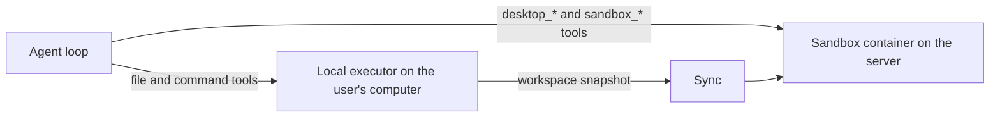

# F7. Stage 2: sandbox for local sessions

Part of [F7](README.md). Covers GUI-11 and GUI-12. A design sketch: it is not scheduled, it starts only after phase 1.6 shows that stage 1 works well enough to justify it, and its open questions must be answered first.

## Problem

A local session runs its executor on the user's computer, which is a Windows machine in the common case. There is no Linux display there and the stage 1 tools are not offered. The code the agent is changing lives on that computer, not in a server container.

## Direction

A **sandbox** is a second executor for a session: a container started from the same image, with the same `pointer-runner` binary and the `desktop` capability, created by the `container` module on demand. The session keeps its local executor for files and commands; the desktop tools are routed to the sandbox.

## Sub-phases

1. **2.1 Sandbox device.** A device kind `sandbox` next to `runner`: created per local session on the first `sandbox_open`, with its own runner secret, token and idle stop, reusing the lifecycle of [ADR 0016](../../adr/0016-remote-execution-in-containers.md). `ExecutionService` learns that a session can have two executor devices and routes an operation to the device that offers its capability. Cost: the single-executor assumption of the execution module and of the `waiting_for_executor` status.
2. **2.2 Getting the code in.** `sandbox_sync` uploads a snapshot of the project (the tracked and untracked files, respecting `.gitignore`) from the local executor to the sandbox as an archive through the backend, and extracts it into the sandbox workspace. Edits stay local; the sandbox is for running and observing, and a changed file reaches it with the next sync. Size, file count and secret-looking files (`.env`, key files) are bounded and reported to the agent before upload.
3. **2.3 Running and observing.** The stage 1 tools, unchanged, against the sandbox, plus `sandbox_run` (a command in the sandbox workspace, for builds and installs) because `run_command` goes to the local executor. Build output and screenshots come back through the same channels as in stage 1.
4. **2.4 Consent and UI.** A notice at first use that the project files are sent to the server's container, an approval for each sync by default, a visible state of the sandbox in the session header, a Desktop panel as in stage 1.
5. **2.5 Lifecycle and limits.** Idle stop and removal, a cap on sandboxes per user, and a switch per project to forbid the sandbox.

## Open questions

- **Where the sandbox runs.** On the backend host, as designed above, or in the user's local Docker. The host option reuses the existing `container` module but sends the code to the server and cannot reach services on the user's computer (a local database, a dev server). The local option keeps the code on the machine and reaches local services through the Docker network, but makes Docker a dependency of the client, and on Windows Home Docker Desktop runs Linux containers only through WSL 2. Both can coexist behind one device abstraction; the first version should pick one.
- **Privacy.** The code already goes to the model provider, but a container on the server adds a second copy and a place where dependencies are installed from the network. Whether that needs an explicit opt-in per project, and how long snapshots live.
- **Sync method.** An archive upload is simple and independent of git. The alternative is to use the project's GitHub repository ([ADR 0016](../../adr/0016-remote-execution-in-containers.md)) plus a patch for uncommitted changes, which is smaller but needs the repository and the user's token.
- **Services.** A project that needs a database or a broker has to start them inside the sandbox in both options unless the local Docker option is chosen and the services run on the machine.
- **Two executors.** Whether other tools should be allowed to target the sandbox (for example `read_file` of a build output), or the sandbox stays a closed box with its own small set of tools.
